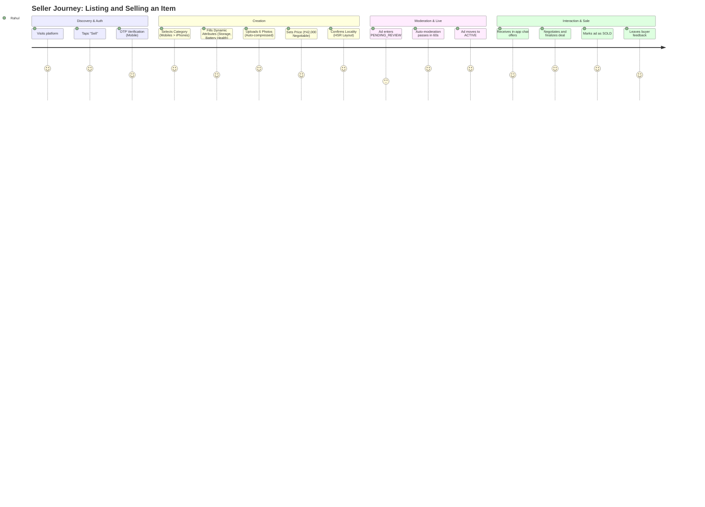
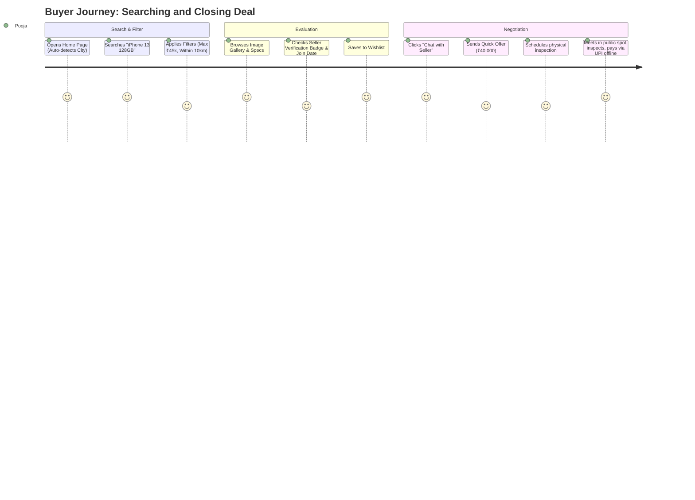

# 01. Product Requirements Document (PRD) — OLX India Clone

---

## 1. Document Control & Metadata
- **Product Name**: OLX ORBIT (Working Title: OLX India Production Architecture)
- **Target Geography**: India (Tier 1, Tier 2, Tier 3 cities & towns)
- **Document Version**: 1.0.0
- **Status**: Draft for Architectural Approval
- **Author**: Principal Software Architect & Senior Full-Stack Engineer

---

## 2. Executive Summary & Vision
OLX ORBIT is a mobile-first, hyper-local peer-to-peer (P2P) classifieds platform engineered specifically for the Indian consumer and small-business ecosystem. The platform enables individuals and local micro-merchants to buy, sell, or rent goods (cars, bikes, mobiles, electronics, furniture, properties) and discover local services/jobs. 

### Market Realities in India & Core Differentiators
1. **Low-Trust Environment**: Fraud prevention, spam detection, verified badges, and phone-masking are critical from Day 1.
2. **Mobile Dominance & Varied Connectivity**: 90%+ traffic comes from smartphones on 4G/5G connections with varying latency. Mobile-first responsive UI, image compression before upload, and aggressive caching are non-negotiable.
3. **Hyper-local Context**: Indian buyers search by locality and city (e.g., "Koramangala, Bengaluru" or "Rohini Sector 7, Delhi"). Radial geo-search and locality hierarchy are central to discovery.
4. **Offline Deal Closure**: v1 focuses entirely on classifieds discovery and negotiation via in-app real-time chat and masked calling. Zero online escrow payment risk in v1.

---

## 3. User Personas

| Persona | Demographics | Motivation & Goals | Pain Points / Fears |
| :--- | :--- | :--- | :--- |
| **Rahul Sharma (Individual Seller)** | 28, Software Engineer, Bengaluru | Wants to sell his used iPhone and 2-wheeler before relocating. Wants quick genuine buyers without getting spammed. | Scammers sending fake QR codes; random unknown calls at odd hours; spam lowball offers. |
| **Pooja Patel (Bargain Buyer)** | 22, College Student, Ahmedabad | Looking for a second-hand study table and laptop under a strict budget. | Misleading photos; hidden defects; distance to seller's location too far; unresponsive sellers. |
| **Amit Verma (Local Small Dealer)** | 42, Used Car Dealer, Indore | Posts 15–20 cars a month. Needs visibility, high lead volume, and quick ad posting flow. | High listing fees; tedious posting forms; managing multiple inquiries manually. |
| **Priya Nair (Moderator / Admin)** | 26, Trust & Safety Team, Remote | Reviews flagged ads, detects fake accounts, monitors banned items (pets restrictions, adult services, counterfeit goods). | High volume of duplicate ads; lack of automated visual/text screening; cumbersome moderation tools. |

---

## 4. User Journey Maps

### 4.1 Seller Journey (Post-to-Sold)

### 4.2 Buyer Journey (Search-to-Negotiate)

---

## 5. Feature List & MoSCoW Prioritization

### 5.1 Must Have (v1 — MVP Production Scope)
- **Authentication**: Phone OTP (primary) + Google OAuth, JWT with refresh token rotation.
- **Location Engine**: Hierarchical State -> City -> Locality selection + PostGIS coordinates radius search.
- **Dynamic Category & Attribute Engine**: Nested taxonomy (up to 3 levels) with custom dynamic attributes (e.g. Car: Fuel Type, Transmission, KM Driven; Mobile: Brand, RAM, Storage).
- **Ad Lifecycle Management**: Multi-step post ad form, client-side WebP compression, server-side pipeline (up to 12 images), status transitions (`DRAFT`, `PENDING_REVIEW`, `ACTIVE`, `REJECTED`, `EXPIRED`, `SOLD`).
- **Discovery & Search**: Full-text trigram search with typo-tolerance, location filtering, dynamic facet filtering, multi-criteria sorting.
- **Real-Time Messaging**: 1-on-1 buyer-seller chat room bound to specific ad, Socket.io with Redis adapter, image attachments, unread counters, delivery receipts.
- **Trust & Moderation**: Report ad/user, block user, admin moderation queue, phone number masking (click to reveal after login).
- **User Dashboard (My Ads)**: Tabbed ad status management, views/favorites counters, mark as sold, ad renewal.
- **Notifications**: In-app notification center, Web Push (FCM), transactional SMS for OTP.
- **SEO & Social Sharing**: Server-rendered public ad and category pages (Next.js), dynamic OpenGraph tags, schema.org `Product` and `BreadcrumbList` JSON-LD.
- **Admin Portal**: Moderation queues, category/attribute CRUD builder, user bans, banner management.

### 5.2 Should Have (v1.5 — Fast Follow)
- **Seller Rating & Reviews**: Post-transaction review submission (1–5 stars + text) once an ad is marked sold.
- **Saved Searches & Instant Alerts**: User saves search filter set; receives push/email when matching ad is posted.
- **Seller Public Storefront**: `/seller/[username-or-id]` showing verified badges, active listings, and rating summaries.
- **Automated Anti-Spam (Text/Image)**: Rule engine detecting blacklisted words, duplicate images (pHash), and phone numbers in image text (OCR).
- **Featured Ad Badging (Manual / Admin)**: Ability for admins to pin ads as "Featured" or "Urgent" on city homepages.

### 5.3 Could Have (v2 — Monetization & Scale)
- **Self-Serve Paid Promotions (Razorpay)**: Sellers pay ₹99–₹999 to boost ads (Top of Category, Urgent badge, Home Page spotlight) for 7/14/30 days.
- **Verified Business Seller Subscription**: Monthly pack for dealers (unlimited listings, analytics dashboard, custom branding).
- **In-App Audio Calling**: WebRTC-based masked audio calls to protect seller privacy without exposing real phone numbers.
- **AI Ad Auto-fill**: Upload photo -> Vision AI infers Category, Brand, Model, and suggests title/description.

### 5.4 Won't Have (v1 — Explicitly Out of Scope)
- In-app payment escrow / shipping logistics integration (cash/UPI on delivery handled peer-to-peer).
- B2C E-commerce cart and multi-item checkout.
- Video streaming / live shopping.

---

## 6. Functional Requirements (FR) Matrix

| Module | ID | Requirement Description | Acceptance Criteria |
| :--- | :--- | :--- | :--- |
| **Auth** | FR-01 | Phone OTP Login | System delivers 6-digit OTP within 15s via SMS gateway; expires in 5 minutes; max 3 retries. |
| **Auth** | FR-02 | Token Lifecycle | Access token valid for 15 minutes; refresh token valid for 30 days stored in HttpOnly cookie; rotated on use. |
| **Category** | FR-03 | Dynamic Attributes | Post Ad form dynamically renders input components (dropdown, number, boolean, multi-select) based on leaf category ID. |
| **Listing** | FR-04 | Media Processing | User selects up to 12 images; client compresses to < 1.5MB; server uploads to S3, converts to WebP, generates thumbnail (`300x300`) and detail (`1200x900`) sizes. |
| **Listing** | FR-05 | Auto-Expiry | Ads remain active for 30 days. BullMQ cron checks daily and transitions expired ads to `EXPIRED` status with notification. |
| **Chat** | FR-06 | Realtime Chat Room | Chat initiated from Ad detail page creates conversation between buyer, seller, and adId. Messages delivered via Socket.io in < 200ms. |
| **Search** | FR-07 | Geo-filtering | User can filter ads within a radius of 5km, 10km, 25km, 50km from user coordinates or selected city center. |

---

## 7. Non-Functional Requirements (NFR)

1. **Performance**:
   - P95 Server Response Time for read APIs < 150ms.
   - P95 Search query latency < 200ms with 500,000 active ads.
   - Core Web Vitals on mobile (Next.js SSR): LCP < 2.5s, FID/INP < 100ms, CLS < 0.1.
2. **Availability & Resilience**:
   - 99.9% uptime target.
   - Graceful degradation: If Redis is temporarily unreachable, chat falls back to HTTP polling, and search falls back to un-cached DB query.
3. **Scalability**:
   - Monolithic backend designed with modular bounded contexts, stateless HTTP servers, and Socket.io instances backed by Redis Pub/Sub to scale horizontally behind Nginx / ALB.
4. **Data Security & Privacy**:
   - Passwords and sensitive PII encrypted at rest.
   - Seller phone numbers hidden by default behind an authenticated click-to-view rate limiter (max 15 reveals per user per day).

---

## 8. Trade-Offs, Risks & Mitigations

| Risk / Trade-Off | Impact | Architectural Mitigation |
| :--- | :--- | :--- |
| **Next.js vs Vite for Web App** | Next.js adds server runtime overhead vs static SPA. | **Decision**: Next.js is strictly required for consumer web because classifieds depend entirely on organic Google indexing for long-tail keywords (e.g. "used honda city in surat"). Admin panel stays on Vite SPA. |
| **PostgreSQL Full-Text vs Dedicated Search Engine (Meilisearch)** | Postgres full-text (`pg_trgm`) has scale limits past millions of rows. | **Decision**: Implement a clean `SearchProvider` interface. Phase 1 starts with Postgres `pg_trgm` + GIN indexes (zero extra infra costs, transactional consistency). Phase 2 can seamlessly toggle `MeiliSearchProvider` without touching controllers. |
| **Buyer-Seller Fraud (Advance Fee Scams)** | High reputation risk in Indian market. | **Decision**: Prominent warning banners inside chat window ("Never send money in advance or scan QR codes"); automated regex blocking UPI IDs and payment links in first 2 messages. |

---

## 9. Open Questions & Assumptions
- **Assumed**: All listings in v1 are free of charge. No monetized payment gateway integration is needed in the initial release.
- **Assumed**: SMS OTP gateway will use MSG91/Twilio with an abstract adapter interface, defaulting to mock OTP (`123456`) in `development` environment.
- **Question for Review**: Should newly posted ads be auto-approved immediately by default (`ACTIVE`), or hold in `PENDING_REVIEW` queue for admin moderation? *(Current assumption: Auto-approve with post-moderation and report triggers, except for high-risk categories like Jobs and Services).*
