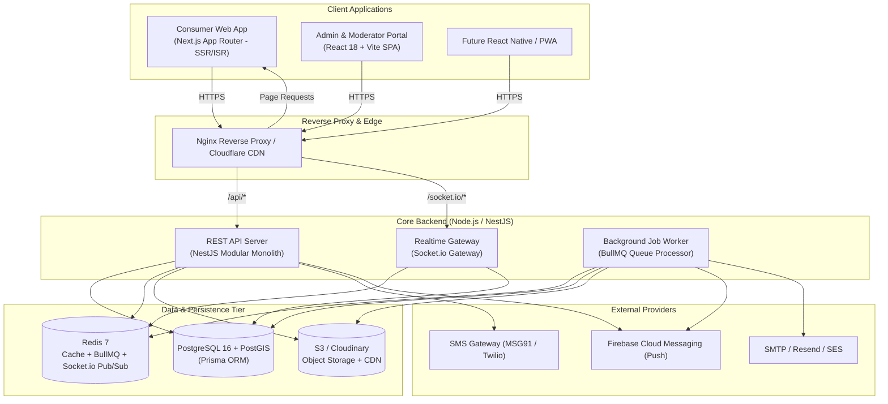
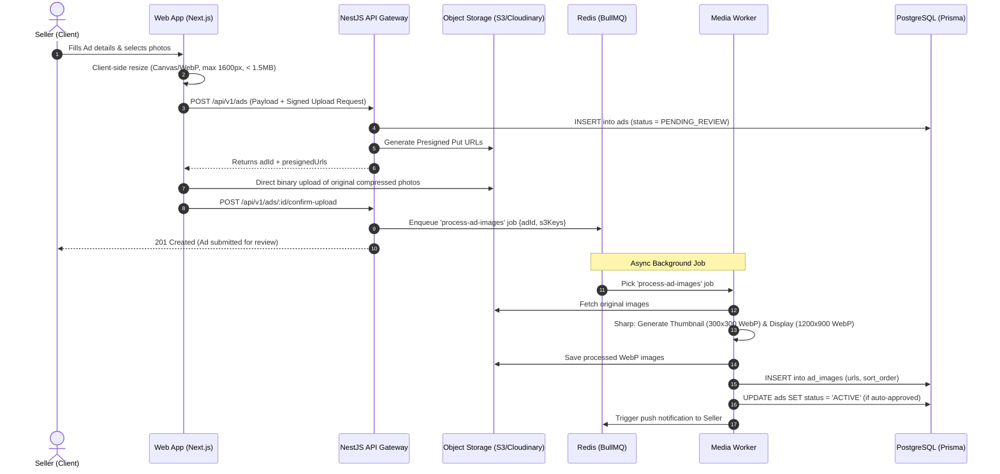
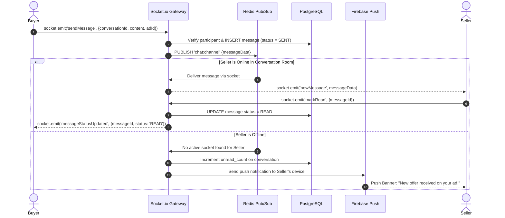

# 02. System Architecture & Tech Stack Evaluation

---

## 1. Architectural Principles & Overview

The platform is designed around the **Modular Monolith** pattern within a high-performance **Turborepo monorepo**. It balances extreme developer velocity for early-stage development with strict domain boundaries, preparing the system for an eventual transition into microservices (e.g., splitting Chat or Search) once traffic reaches scale.



---

## 2. Core Architectural Decisions & Justifications

### 2.1 Frontend Framework: Next.js (App Router) vs. Vite + Prerender
* **Recommendation**: **Next.js (App Router, React 19/18, TypeScript, Tailwind CSS)** for `apps/web`.
* **Decision Evaluation**:
  | Criterion | Next.js App Router | Vite + Prerender / Edge SSR |
  | :--- | :--- | :--- |
  | **SEO & Crawlability** | Native hybrid SSR, ISR, and dynamic metadata generation per route. | Fragile headless browser pre-rendering; sync delays when ads are edited/sold. |
  | **Core Web Vitals** | Server components send zero client-bundle for static content. | Client bundle contains entire routing tree; slower initial hydration on budget Android devices. |
  | **Ecosystem & Community** | De-facto standard for marketplace platforms with millions of routes. | Requires bespoke edge workers, custom cache invalidation, and custom server infrastructure. |
* **Verdict**: For a classifieds business where **85%+ of inbound traffic relies on programmatic SEO** (e.g., `/ad/maruti-swift-vxi-2018-bangalore-12345`), Next.js is strictly superior. `apps/admin` uses **Vite SPA** because it is behind an authentication wall where SEO is irrelevant.

### 2.2 Backend Framework: NestJS vs. Express.js
* **Recommendation**: **NestJS (TypeScript)** for `apps/api`.
* **Decision Evaluation**:
  | Criterion | NestJS | Express.js |
  | :--- | :--- | :--- |
  | **Architecture Enforced** | Modular dependency injection, separation of Concerns (Controller -> Service -> Repository). | Unstructured; prone to "spaghetti code" across teams without strict manual linting. |
  | **Type Safety & Validation** | Native `class-validator`, `class-transformer`, automatic Swagger/OpenAPI doc generation. | Requires manual wiring of Zod/Joi middleware, manual Swagger maintenance. |
  | **WebSocket & Microservices** | Native `@WebSocketGateway()` with seamless Redis adapter support. | Requires manual Socket.io server instance attachment and event plumbing. |
  | **Worker Queue Integration** | First-class `@nestjs/bullmq` module for job producers and consumers. | Requires manual lifecycle management of BullMQ workers. |
* **Verdict**: NestJS guarantees architectural consistency, enterprise maintainability, and built-in TypeScript decorators while running on top of Node.js and Express under the hood.

---

## 3. High-Level Request Flows

### 3.1 Ad Creation & Image Pipeline Flow


### 3.2 Real-Time Chat Request & Delivery Flow


---

## 4. Monorepo Repository Structure

The project is structured as a **Turborepo** workspace with strict package boundaries:

```
olx-monorepo/
├── .github/
│   └── workflows/
│       ├── ci.yml                 # Lint, test, typecheck
│       ├── deploy-api.yml         # Deploy NestJS container
│       └── deploy-web.yml         # Deploy Next.js SSR container
├── apps/
│   ├── web/                       # Consumer Marketplace (Next.js 14+ App Router)
│   │   ├── src/
│   │   │   ├── app/               # Routes: /, /search, /ad/[slug], /post-ad, /chat
│   │   │   ├── components/        # UI components (Atomic design)
│   │   │   ├── hooks/             # Custom React & TanStack query hooks
│   │   │   ├── stores/            # Zustand stores (location, auth, chat)
│   │   │   └── services/          # HTTP API client layer
│   │   ├── public/
│   │   ├── next.config.mjs
│   │   ├── tailwind.config.ts
│   │   └── package.json
│   │
│   ├── admin/                     # Admin & Moderation Portal (React 18 + Vite)
│   │   ├── src/
│   │   │   ├── pages/             # Dashboard, ModerationQueue, Categories, Users
│   │   │   ├── components/        # Tables, filters, charts, review modals
│   │   │   └── api/               # Admin endpoints client
│   │   ├── vite.config.ts
│   │   └── package.json
│   │
│   └── api/                       # Core Backend (NestJS Modular Monolith)
│       ├── src/
│       │   ├── common/            # Guards, interceptors, filters, decorators
│       │   ├── config/            # Environment validation (Joi/Zod)
│       │   ├── database/          # Prisma service and PostGIS extensions
│       │   ├── modules/
│       │   │   ├── auth/          # OTP, JWT, Passport strategies
│       │   │   ├── users/         # Profiles, ratings, blocks
│       │   │   ├── categories/    # Nested taxonomy & dynamic attributes
│       │   │   ├── ads/           # CRUD, lifecycle, filters, PostGIS geo queries
│       │   │   ├── search/        # SearchProvider abstraction (Postgres/Meili)
│       │   │   ├── chat/          # Socket.io gateway, conversations, messages
│       │   │   ├── notifications/ # In-app, FCM push, transactional SMS
│       │   │   ├── moderation/    # Reports, audit logs, auto-moderation
│       │   │   └── media/         # Presigned URLs, Sharp processing
│       │   ├── workers/           # BullMQ processors (media, cleanup, notifications)
│       │   ├── app.module.ts
│       │   └── main.ts
│       ├── test/
│       └── package.json
│
├── packages/
│   ├── database/                  # Prisma schema, migrations, seeders
│   │   ├── prisma/
│   │   │   ├── schema.prisma
│   │   │   ├── migrations/
│   │   │   └── seeds/
│   │   ├── src/index.ts           # Exported PrismaClient instance
│   │   └── package.json
│   │
│   ├── shared/                    # Shared DTOs, Enums, Types, Constants
│   │   ├── src/
│   │   │   ├── enums/             # AdStatus, UserRole, BoostType
│   │   │   ├── types/             # Common API interfaces, pagination
│   │   │   └── validators/        # Zod / class-validator schemas
│   │   └── package.json
│   │
│   ├── ui/                        # Shared design tokens & primitive UI components
│   │   ├── src/
│   │   └── package.json
│   │
│   ├── tsconfig/                  # Shared base tsconfig files
│   └── eslint-config/             # Shared ESLint & Prettier configurations
│
├── docker/
│   ├── docker-compose.yml         # Local dev: Postgres+PostGIS, Redis, MinIO
│   ├── Dockerfile.api
│   └── Dockerfile.web
├── turbo.json
└── package.json                   # Root package.json (pnpm-workspace)
```

---

## 5. Backend Module Breakdown (NestJS)

| Module | Core Responsibilities | Key Dependencies |
| :--- | :--- | :--- |
| **AuthModule** | Phone OTP verification, refresh token rotation, rate limiting, Google OAuth. | `PrismaModule`, `SmsModule`, `RedisModule` |
| **CategoryModule**| Nested hierarchical categories (e.g. Vehicles -> Cars -> Hatchbacks), dynamic attribute schemas with validation rules. | `PrismaModule`, `CacheModule` |
| **AdsModule** | Ad lifecycle state machine (`DRAFT` -> `ACTIVE` -> `SOLD`), PostGIS location query execution, dynamic attribute values validation. | `PrismaModule`, `SearchModule`, `MediaModule` |
| **SearchModule** | `SearchProvider` interface implementation with query sanitization, trigram index querying, facet aggregation. | `PrismaModule`, `RedisModule` |
| **ChatModule** | Socket.io server gateway, Redis socket adapter, conversation creation, message persistence, read receipts. | `PrismaModule`, `RedisModule`, `NotificationModule` |
| **MediaModule** | High-performance local storage ingestion, Sharp Libvips WebP multi-resolution rendering (thumb, card, med, large), single-source-of-truth URL generation, Nginx direct kernel delivery with Fastify fallback. | `BullModule`, `Sharp`, `PrismaModule` |
| **ModerationModule**| User reports, keyword blacklist filtering, duplicate ad detection (pHash matching), admin approval queue. | `PrismaModule`, `NotificationModule` |
| **NotificationModule**| Push notifications (Firebase FCM), SMS delivery, in-app notification state. | `BullModule`, `FirebaseAdmin` |

---

## 6. Scalability, Caching & Performance Plan

1. **Stateless Web & API Tiers**:
   - Fastify 5 API nodes and React 18 client containers maintain zero local application state. Any node can handle any request behind an Nginx gateway or cloud load balancer.
2. **Socket.io Horizontal Scaling**:
   - Real-time WebSockets connect through `@socket.io/redis-adapter`. When Node A receives a message intended for a client connected to Node B, Redis Pub/Sub routes the payload seamlessly between processes.
3. **Multi-Tier Caching Strategy**:
   - **L1 (HTTP Edge / Nginx)**: Static assets, images (`/media/*`), and SPA bundles served directly with kernel-level zero-copy `sendfile` and 30-day immutable caching.
   - **L2 (Redis Memory Cache)**:
     - Categories and attribute schemas: Cached with a 24-hour TTL (`categories:all`). Invalidation triggered only on admin update.
     - Location list (States, Cities, Localities): Cached indefinitely (`locations:india`).
     - Ad search catalog feeds: Cached with short TTL to absorb traffic surges.
   - **L3 (Database Query Optimization)**:
     - Composite B-Tree indexes on `(status, category_id, created_at DESC)`.
     - Spatial GiST index on `location_coords` using PostGIS `ST_DWithin`.
     - GIN trigram indexes on `ad.title` and `ad.description`.

---

## 7. Trade-offs & Risks
1. **Monolith vs Microservices**: A microservices architecture at this stage would introduce high operational overhead (Kubernetes, service meshes, distributed transactions). A modular monolith with strictly enforced clean modules allows single-command deployments, shared transactions, and 10x faster feature iteration.
2. **Prisma with PostGIS**: Prisma does not natively support PostGIS spatial types (e.g., `Unsupported("geography(Point, 4326)")`). 
   - *Mitigation*: We maintain lat/lng columns in Prisma for simple reads and use Prisma's `$queryRaw` for spatial radius calculations (`ST_DWithin`, `ST_Distance`).

---

## 8. Open Questions & Assumptions
- **Media Storage**: High-efficiency persistent volume storage (`/data/olx-media`) with zero S3 / MinIO dependencies. Delivers through Nginx kernel `sendfile` with dynamic Fastify streaming fallback.
- **Listing Limits**: Maximum 12 images per ad, with a maximum file size of 15MB per original image before background WebP compilation.
- **Multilingual Support**: English primary with Hindi/regional terms supported in search queries.
