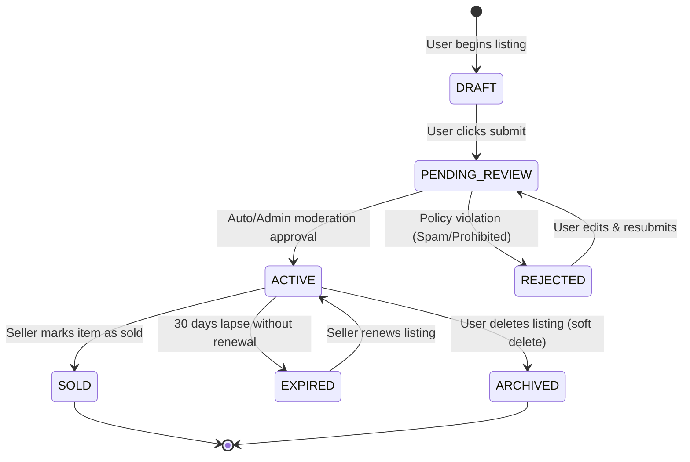
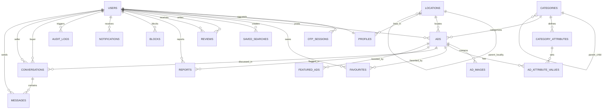

# 03. Database Schema & Data Modeling

---

## 1. Overview & Architectural Principles

The database tier is powered by **PostgreSQL 16** with the **PostGIS** extension for spatial geo-indexing. Data access is governed by **Prisma ORM** within `packages/database`. 

### Key Design Tenets
1. **Performance at Scale**: Heavy read paths (Home feed, Search, Ad Detail) rely on composite indexes, partial indexes for `ACTIVE` status, and spatial GiST indexes for radius queries.
2. **Dynamic Attributes EAV Hybrid**: Categories have custom dynamic fields (e.g. Car: Mileage, Fuel; Mobile: Storage, RAM). We use a normalized relational schema (`category_attributes` and `ad_attribute_values`) combined with a denormalized JSONB snapshot on the `ads` table for single-query zero-join reads.
3. **Soft Deletes**: Key operational tables (`users`, `ads`) utilize `deleted_at` timestamps to preserve referential integrity for audit trails and dispute resolution.
4. **Ad Status Lifecycle**:


---

## 2. Entity-Relationship (ER) Diagram



---

## 3. Complete Prisma Schema (`schema.prisma`)

```prisma
datasource db {
  provider = "postgresql"
  url      = env("DATABASE_URL")
}

generator client {
  provider        = "prisma-client-js"
  previewFeatures = ["fullTextSearch", "postgresqlExtensions"]
  extensions      = [postgis, pg_trgm]
}

// ============================================================================
// ENUMS
// ============================================================================

enum UserRole {
  GUEST
  USER
  MODERATOR
  ADMIN
}

enum UserStatus {
  ACTIVE
  SUSPENDED
  BANNED
  DELETED
}

enum OtpPurpose {
  LOGIN
  REGISTER
  PHONE_UPDATE
  TRANSACTION_VERIFY
}

enum AttributeType {
  TEXT
  NUMBER
  BOOLEAN
  SELECT
  MULTI_SELECT
  DATE
}

enum AdStatus {
  DRAFT
  PENDING_REVIEW
  ACTIVE
  REJECTED
  EXPIRED
  SOLD
  ARCHIVED
}

enum BoostType {
  FEATURED      // Top of category & search results
  URGENT        // Urgent badge
  HOME_SPOTLIGHT // Displayed on homepage top carousel
}

enum BoostStatus {
  PENDING
  ACTIVE
  EXPIRED
  CANCELLED
}

enum MessageType {
  TEXT
  IMAGE
  LOCATION
  SYSTEM_NOTICE
}

enum MessageStatus {
  SENT
  DELIVERED
  READ
}

enum NotificationType {
  CHAT_MESSAGE
  AD_APPROVED
  AD_REJECTED
  AD_EXPIRING_SOON
  PRICE_DROP
  SAVED_SEARCH_MATCH
  SYSTEM_ALERT
}

enum ReportReason {
  SPAM_OR_FRAUD
  INAPPROPRIATE_CONTENT
  PROHIBITED_ITEM
  MISLEADING_PRICE
  DUPLICATE_LISTING
  ALREADY_SOLD
  OTHER
}

enum ReportStatus {
  PENDING
  UNDER_REVIEW
  RESOLVED
  DISMISSED
}

// ============================================================================
// USER & IDENTITY MODELS
// ============================================================================

model User {
  id              String       @id @default(uuid()) @db.Uuid
  phoneNumber     String?      @unique @map("phone_number") @db.VarChar(15)
  isPhoneVerified Boolean      @default(false) @map("is_phone_verified")
  email           String?      @unique @db.VarChar(255)
  isEmailVerified Boolean      @default(false) @map("is_email_verified")
  passwordHash    String?      @map("password_hash") @db.VarChar(255)
  googleId        String?      @unique @map("google_id") @db.VarChar(255)
  role            UserRole     @default(USER)
  status          UserStatus   @default(ACTIVE)
  refreshTokenHash String?     @map("refresh_token_hash") @db.VarChar(255)
  lastLoginAt     DateTime?    @map("last_login_at")
  createdAt       DateTime     @default(now()) @map("created_at")
  updatedAt       DateTime     @updatedAt @map("updated_at")
  deletedAt       DateTime?    @map("deleted_at")

  profile         Profile?
  otpSessions     OtpSession[]
  ads             Ad[]
  favourites      Favourite[]
  savedSearches   SavedSearch[]
  buyerConvs      Conversation[] @relation("BuyerConversations")
  sellerConvs     Conversation[] @relation("SellerConversations")
  messagesSent    Message[]      @relation("SentMessages")
  notifications   Notification[]
  reportsFiled    Report[]       @relation("ReporterUser")
  reportsReceived Report[]       @relation("ReportedUser")
  blocksMade      Block[]        @relation("BlockingUser")
  blocksReceived  Block[]        @relation("BlockedUser")
  reviewsGiven    Review[]       @relation("ReviewAuthor")
  reviewsReceived Review[]       @relation("ReviewTarget")
  auditLogs       AuditLog[]

  @@index([phoneNumber])
  @@index([email])
  @@index([role, status])
  @@map("users")
}

model Profile {
  id            String    @id @default(uuid()) @db.Uuid
  userId        String    @unique @map("user_id") @db.Uuid
  name          String    @db.VarChar(100)
  avatarUrl     String?   @map("avatar_url") @db.VarChar(500)
  bio           String?   @db.VarChar(500)
  locationId    String?   @map("location_id") @db.Uuid
  ratingAverage Decimal   @default(0.0) @map("rating_average") @db.Decimal(3, 2)
  ratingCount   Int       @default(0) @map("rating_count")
  isIdentityVerified Boolean @default(false) @map("is_identity_verified")
  createdAt     DateTime  @default(now()) @map("created_at")
  updatedAt     DateTime  @updatedAt @map("updated_at")

  user          User      @relation(fields: [userId], references: [id], onDelete: Cascade)
  location      Location? @relation(fields: [locationId], references: [id], onDelete: SetNull)

  @@map("profiles")
}

model OtpSession {
  id          String     @id @default(uuid()) @db.Uuid
  userId      String?    @map("user_id") @db.Uuid
  phoneNumber String     @map("phone_number") @db.VarChar(15)
  otpHash     String     @map("otp_hash") @db.VarChar(255)
  purpose     OtpPurpose @default(LOGIN)
  attempts    Int        @default(0)
  isUsed      Boolean    @default(false) @map("is_used")
  expiresAt   DateTime   @map("expires_at")
  createdAt   DateTime   @default(now()) @map("created_at")

  user        User?      @relation(fields: [userId], references: [id], onDelete: Cascade)

  @@index([phoneNumber, isUsed, expiresAt])
  @@map("otp_sessions")
}

// ============================================================================
// LOCATION & GEO-SPATIAL MODELS
// ============================================================================

model Location {
  id          String     @id @default(uuid()) @db.Uuid
  name        String     @db.VarChar(100)
  slug        String     @db.VarChar(120)
  parentId    String?    @map("parent_id") @db.Uuid
  type        String     @db.VarChar(20) // STATE, CITY, LOCALITY
  latitude    Float
  longitude   Float
  pincode     String?    @db.VarChar(10)
  createdAt   DateTime   @default(now()) @map("created_at")
  updatedAt   DateTime   @updatedAt @map("updated_at")

  parent      Location?  @relation("LocationHierarchy", fields: [parentId], references: [id], onDelete: Restrict)
  children    Location[] @relation("LocationHierarchy")
  ads         Ad[]
  profiles    Profile[]

  @@unique([slug, parentId])
  @@index([type, parentId])
  @@index([latitude, longitude])
  @@map("locations")
}

// ============================================================================
// CATEGORY & DYNAMIC ATTRIBUTES
// ============================================================================

model Category {
  id          String              @id @default(uuid()) @db.Uuid
  name        String              @db.VarChar(100)
  slug        String              @unique @db.VarChar(120)
  description String?             @db.VarChar(500)
  iconUrl     String?             @map("icon_url") @db.VarChar(500)
  parentId    String?             @map("parent_id") @db.Uuid
  displayOrder Int                @default(0) @map("display_order")
  isActive    Boolean             @default(true) @map("is_active")
  createdAt   DateTime            @default(now()) @map("created_at")
  updatedAt   DateTime            @updatedAt @map("updated_at")

  parent      Category?           @relation("CategoryHierarchy", fields: [parentId], references: [id], onDelete: Restrict)
  children    Category[]          @relation("CategoryHierarchy")
  attributes  CategoryAttribute[]
  ads         Ad[]

  @@index([parentId, isActive, displayOrder])
  @@map("categories")
}

model CategoryAttribute {
  id           String             @id @default(uuid()) @db.Uuid
  categoryId   String             @map("category_id") @db.Uuid
  name         String             @db.VarChar(100)
  key          String             @db.VarChar(50) // e.g. "fuel_type", "kms_driven"
  type         AttributeType
  options      Json?              // For SELECT / MULTI_SELECT: ["Petrol", "Diesel", "CNG", "Electric"]
  isRequired   Boolean            @default(false) @map("is_required")
  isFilterable Boolean            @default(true) @map("is_filterable")
  unit         String?            @db.VarChar(20) // "KM", "GB", "BHK", "Sq.Ft"
  displayOrder Int                @default(0) @map("display_order")
  createdAt    DateTime           @default(now()) @map("created_at")
  updatedAt    DateTime           @updatedAt @map("updated_at")

  category     Category           @relation(fields: [categoryId], references: [id], onDelete: Cascade)
  values       AdAttributeValue[]

  @@unique([categoryId, key])
  @@index([categoryId, isFilterable])
  @@map("category_attributes")
}

// ============================================================================
// CLASSIFIED ADS & MEDIA
// ============================================================================

model Ad {
  id              String             @id @default(uuid()) @db.Uuid
  userId          String             @map("user_id") @db.Uuid
  categoryId      String             @map("category_id") @db.Uuid
  locationId      String             @map("location_id") @db.Uuid
  title           String             @db.VarChar(150)
  slug            String             @unique @db.VarChar(200)
  description     String             @db.Text
  price           Decimal            @db.Decimal(12, 2)
  isNegotiable    Boolean            @default(true) @map("is_negotiable")
  status          AdStatus           @default(PENDING_REVIEW)
  rejectionReason String?            @map("rejection_reason") @db.VarChar(255)
  viewCount       Int                @default(0) @map("view_count")
  chatCount       Int                @default(0) @map("chat_count")
  favouriteCount  Int                @default(0) @map("favourite_count")
  attributesCache Json?              @map("attributes_cache") // Denormalized EAV for zero-join reads
  contactPreference String           @default("CHAT_AND_CALL") @map("contact_preference") @db.VarChar(30)
  latitude        Float
  longitude       Float
  expiresAt       DateTime           @map("expires_at")
  renewedAt       DateTime?          @map("renewed_at")
  createdAt       DateTime           @default(now()) @map("created_at")
  updatedAt       DateTime           @updatedAt @map("updated_at")
  deletedAt       DateTime?          @map("deleted_at")

  user            User               @relation(fields: [userId], references: [id], onDelete: Cascade)
  category        Category           @relation(fields: [categoryId], references: [id], onDelete: Restrict)
  location        Location           @relation(fields: [locationId], references: [id], onDelete: Restrict)
  images          AdImage[]
  attributeValues AdAttributeValue[]
  favourites      Favourite[]
  conversations   Conversation[]
  reports         Report[]
  featuredBoosts  FeaturedAd[]

  @@index([status, categoryId, createdAt(sort: Desc)])
  @@index([status, locationId, createdAt(sort: Desc)])
  @@index([status, price])
  @@index([userId, status])
  @@index([latitude, longitude])
  @@map("ads")
}

model AdImage {
  id           String    @id @default(uuid()) @db.Uuid
  adId         String    @map("ad_id") @db.Uuid
  originalUrl  String    @map("original_url") @db.VarChar(500)
  displayUrl   String    @map("display_url") @db.VarChar(500)   // 1200x900 WebP
  thumbnailUrl String    @map("thumbnail_url") @db.VarChar(500) // 300x300 WebP
  sortOrder    Int       @default(0) @map("sort_order")
  isCover      Boolean   @default(false) @map("is_cover")
  createdAt    DateTime  @default(now()) @map("created_at")

  ad           Ad        @relation(fields: [adId], references: [id], onDelete: Cascade)

  @@index([adId, sortOrder])
  @@map("ad_images")
}

model AdAttributeValue {
  id          String            @id @default(uuid()) @db.Uuid
  adId        String            @map("ad_id") @db.Uuid
  attributeId String            @map("attribute_id") @db.Uuid
  value       String            @db.Text
  createdAt   DateTime          @default(now()) @map("created_at")

  ad          Ad                @relation(fields: [adId], references: [id], onDelete: Cascade)
  attribute   CategoryAttribute @relation(fields: [attributeId], references: [id], onDelete: Cascade)

  @@unique([adId, attributeId])
  @@index([attributeId, value])
  @@map("ad_attribute_values")
}

// ============================================================================
// CHAT & MESSAGING
// ============================================================================

model Conversation {
  id               String        @id @default(uuid()) @db.Uuid
  adId             String        @map("ad_id") @db.Uuid
  buyerId          String        @map("buyer_id") @db.Uuid
  sellerId         String        @map("seller_id") @db.Uuid
  lastMessageText  String?       @map("last_message_text") @db.VarChar(1000)
  lastMessageAt    DateTime?     @map("last_message_at")
  buyerUnreadCount Int           @default(0) @map("buyer_unread_count")
  sellerUnreadCount Int          @default(0) @map("seller_unread_count")
  isBlocked        Boolean       @default(false) @map("is_blocked")
  createdAt        DateTime      @default(now()) @map("created_at")
  updatedAt        DateTime      @updatedAt @map("updated_at")

  ad               Ad            @relation(fields: [adId], references: [id], onDelete: Cascade)
  buyer            User          @relation("BuyerConversations", fields: [buyerId], references: [id], onDelete: Cascade)
  seller           User          @relation("SellerConversations", fields: [sellerId], references: [id], onDelete: Cascade)
  messages         Message[]

  @@unique([adId, buyerId, sellerId])
  @@index([buyerId, lastMessageAt(sort: Desc)])
  @@index([sellerId, lastMessageAt(sort: Desc)])
  @@map("conversations")
}

model Message {
  id             String        @id @default(uuid()) @db.Uuid
  conversationId String        @map("conversation_id") @db.Uuid
  senderId       String        @map("sender_id") @db.Uuid
  type           MessageType   @default(TEXT)
  content        String        @db.Text
  attachmentUrl  String?       @map("attachment_url") @db.VarChar(500)
  status         MessageStatus @default(SENT)
  createdAt      DateTime      @default(now()) @map("created_at")

  conversation   Conversation  @relation(fields: [conversationId], references: [id], onDelete: Cascade)
  sender         User          @relation("SentMessages", fields: [senderId], references: [id], onDelete: Cascade)

  @@index([conversationId, createdAt(sort: Asc)])
  @@map("messages")
}

// ============================================================================
// FAVOURITES & SAVED SEARCHES
// ============================================================================

model Favourite {
  id        String   @id @default(uuid()) @db.Uuid
  userId    String   @map("user_id") @db.Uuid
  adId      String   @map("ad_id") @db.Uuid
  createdAt DateTime @default(now()) @map("created_at")

  user      User     @relation(fields: [userId], references: [id], onDelete: Cascade)
  ad        Ad       @relation(fields: [adId], references: [id], onDelete: Cascade)

  @@unique([userId, adId])
  @@index([userId, createdAt(sort: Desc)])
  @@map("favourites")
}

model SavedSearch {
  id            String   @id @default(uuid()) @db.Uuid
  userId        String   @map("user_id") @db.Uuid
  name          String   @db.VarChar(100)
  queryCriteria Json     @map("query_criteria") // Stores search params: keywords, categoryId, priceRange, etc.
  notifyEmail   Boolean  @default(false) @map("notify_email")
  notifyPush    Boolean  @default(true) @map("notify_push")
  lastNotifiedAt DateTime? @map("last_notified_at")
  createdAt     DateTime @default(now()) @map("created_at")

  user          User     @relation(fields: [userId], references: [id], onDelete: Cascade)

  @@index([userId])
  @@map("saved_searches")
}

// ============================================================================
// TRUST, REVIEWS & MODERATION
// ============================================================================

model Review {
  id         String   @id @default(uuid()) @db.Uuid
  authorId   String   @map("author_id") @db.Uuid
  targetId   String   @map("target_id") @db.Uuid
  rating     Int      @db.SmallInt // 1 to 5 stars
  comment    String?  @db.VarChar(1000)
  createdAt  DateTime @default(now()) @map("created_at")

  author     User     @relation("ReviewAuthor", fields: [authorId], references: [id], onDelete: Cascade)
  target     User     @relation("ReviewTarget", fields: [targetId], references: [id], onDelete: Cascade)

  @@unique([authorId, targetId])
  @@index([targetId, rating])
  @@map("reviews")
}

model Report {
  id          String       @id @default(uuid()) @db.Uuid
  reporterId  String       @map("reporter_id") @db.Uuid
  reportedId  String?      @map("reported_id") @db.Uuid
  adId        String?      @map("ad_id") @db.Uuid
  reason      ReportReason
  details     String?      @db.Text
  status      ReportStatus @default(PENDING)
  adminNote   String?      @map("admin_note") @db.Text
  createdAt   DateTime     @default(now()) @map("created_at")
  updatedAt   DateTime     @updatedAt @map("updated_at")

  reporter    User         @relation("ReporterUser", fields: [reporterId], references: [id], onDelete: Cascade)
  reported    User?        @relation("ReportedUser", fields: [reportedId], references: [id], onDelete: SetNull)
  ad          Ad?          @relation(fields: [adId], references: [id], onDelete: Cascade)

  @@index([status, createdAt(sort: Desc)])
  @@map("reports")
}

model Block {
  id        String   @id @default(uuid()) @db.Uuid
  blockerId String   @map("blocker_id") @db.Uuid
  blockedId String   @map("blocked_id") @db.Uuid
  createdAt DateTime @default(now()) @map("created_at")

  blocker   User     @relation("BlockingUser", fields: [blockerId], references: [id], onDelete: Cascade)
  blocked   User     @relation("BlockedUser", fields: [blockedId], references: [id], onDelete: Cascade)

  @@unique([blockerId, blockedId])
  @@map("blocks")
}

// ============================================================================
// PROMOTIONS, BANNERS & NOTIFICATIONS
// ============================================================================

model FeaturedAd {
  id        String      @id @default(uuid()) @db.Uuid
  adId      String      @map("ad_id") @db.Uuid
  type      BoostType   @default(FEATURED)
  status    BoostStatus @default(ACTIVE)
  startsAt  DateTime    @map("starts_at")
  endsAt    DateTime    @map("ends_at")
  createdAt DateTime    @default(now()) @map("created_at")

  ad        Ad          @relation(fields: [adId], references: [id], onDelete: Cascade)

  @@index([adId, status, endsAt])
  @@map("featured_ads")
}

model Banner {
  id          String   @id @default(uuid()) @db.Uuid
  title       String   @db.VarChar(150)
  imageUrl    String   @map("image_url") @db.VarChar(500)
  targetUrl   String?  @map("target_url") @db.VarChar(500)
  position    String   @default("HOME_HERO") @db.VarChar(50) // HOME_HERO, CATEGORY_TOP
  cityId      String?  @map("city_id") @db.Uuid
  isActive    Boolean  @default(true) @map("is_active")
  displayOrder Int     @default(0) @map("display_order")
  startsAt    DateTime @map("starts_at")
  endsAt      DateTime @map("ends_at")
  createdAt   DateTime @default(now()) @map("created_at")

  @@index([isActive, position, displayOrder])
  @@map("banners")
}

model Notification {
  id        String           @id @default(uuid()) @db.Uuid
  userId    String           @map("user_id") @db.Uuid
  type      NotificationType
  title     String           @db.VarChar(150)
  body      String           @db.VarChar(500)
  data      Json?            // e.g. { "adId": "...", "conversationId": "..." }
  isRead    Boolean          @default(false) @map("is_read")
  createdAt DateTime         @default(now()) @map("created_at")

  user      User             @relation(fields: [userId], references: [id], onDelete: Cascade)

  @@index([userId, isRead, createdAt(sort: Desc)])
  @@map("notifications")
}

model AuditLog {
  id         String   @id @default(uuid()) @db.Uuid
  userId     String?  @map("user_id") @db.Uuid
  action     String   @db.VarChar(100) // e.g. "AD_APPROVED", "USER_BANNED"
  entityType String   @map("entity_type") @db.VarChar(50)
  entityId   String   @map("entity_id") @db.VarChar(50)
  oldData    Json?    @map("old_data")
  newData    Json?    @map("new_data")
  ipAddress  String?  @map("ip_address") @db.VarChar(45)
  userAgent  String?  @map("user_agent") @db.VarChar(500)
  createdAt  DateTime @default(now()) @map("created_at")

  user       User?    @relation(fields: [userId], references: [id], onDelete: SetNull)

  @@index([entityType, entityId])
  @@index([action, createdAt(sort: Desc)])
  @@map("audit_logs")
}
```

---

## 4. PostGIS Native SQL Migration Script

While Prisma manages the relational schema, spatial calculations on `ads` require a PostGIS geometry column and spatial index. The following SQL runs as part of the initial migration (`prisma/migrations/0_init_postgis/migration.sql`):

```sql
-- 1. Enable PostGIS & Trigram extensions
CREATE EXTENSION IF NOT EXISTS postgis;
CREATE EXTENSION IF NOT EXISTS pg_trgm;

-- 2. Add PostGIS geography point column to ads
ALTER TABLE ads ADD COLUMN IF NOT EXISTS location_coords geography(Point, 4326);

-- 3. Populate coordinates from latitude/longitude
UPDATE ads 
SET location_coords = ST_SetSRID(ST_MakePoint(longitude, latitude), 4326)::geography
WHERE location_coords IS NULL AND latitude IS NOT NULL AND longitude IS NOT NULL;

-- 4. Create trigger to auto-sync location_coords on insert/update
CREATE OR REPLACE FUNCTION sync_ad_location_coords()
RETURNS TRIGGER AS $$
BEGIN
  IF NEW.latitude IS NOT NULL AND NEW.longitude IS NOT NULL THEN
    NEW.location_coords := ST_SetSRID(ST_MakePoint(NEW.longitude, NEW.latitude), 4326)::geography;
  END IF;
  RETURN NEW;
END;
$$ LANGUAGE plpgsql;

DROP TRIGGER IF EXISTS trg_sync_ad_location_coords ON ads;
CREATE TRIGGER trg_sync_ad_location_coords
BEFORE INSERT OR UPDATE OF latitude, longitude ON ads
FOR EACH ROW
EXECUTE FUNCTION sync_ad_location_coords();

-- 5. Create GiST spatial index for radius searches (ST_DWithin)
CREATE INDEX IF NOT EXISTS idx_ads_location_coords ON ads USING GIST (location_coords);

-- 6. Create GIN Trigram indexes for typo-tolerant keyword search
CREATE INDEX IF NOT EXISTS idx_ads_title_trgm ON ads USING GIN (title gin_trgm_ops);
CREATE INDEX IF NOT EXISTS idx_ads_description_trgm ON ads USING GIN (description gin_trgm_ops);
```

---

## 5. Trade-Offs & Edge Case Handling

1. **Normalized vs Denormalized Attributes**:
   - Querying dynamic attributes (`RAM = 8GB` and `Storage = 128GB`) across normalized join tables (`ad_attribute_values`) is expensive for large listings.
   - *Architecture*: The normalized table is preserved for strict validation and indexable facet filtering. However, the `ads.attributes_cache` JSONB column stores the complete resolved attribute map for fast single-row reads on the ad detail page.
2. **Concurrent Edits & Optimistic Locking**:
   - Multiple admins or concurrent edits on the same ad are protected by PostgreSQL transactional row-locking (`SELECT ... FOR UPDATE`) in the NestJS service layer.
3. **Soft-Deleted Ads & Expired Links**:
   - When an ad is marked `SOLD` or `ARCHIVED`, its public URL does not return a generic 404. Instead, it renders an "Item Sold / No Longer Available" status card with a carousel of "Similar Active Items in Your City" to protect SEO link equity.

---

## 6. Open Questions & Assumptions
- **Assumed**: Maximum 12 images per ad (`ad_images`).
- **Assumed**: Ad expiration window is set to 30 days from creation/renewal.
- **Question**: Should we retain chat conversations indefinitely, or archive conversations older than 90 days after an ad is marked `SOLD`? *(Current assumption: Retain indefinitely for trust & fraud audit capability).*
