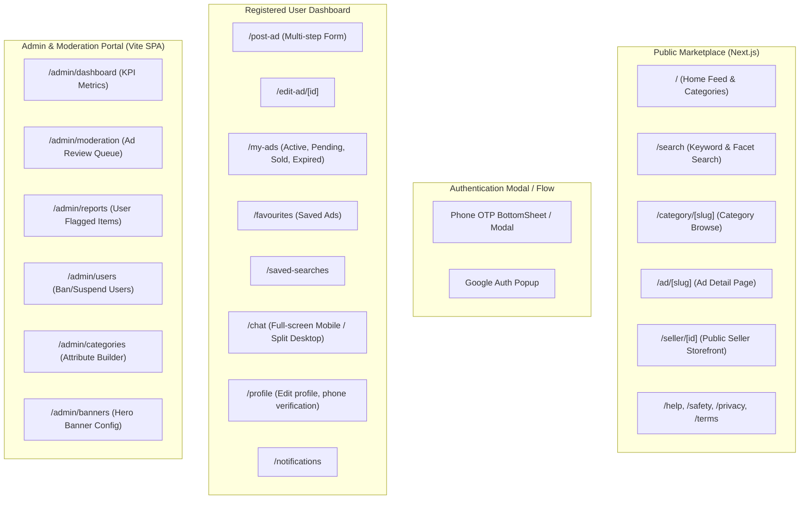

# 05. UI/UX Design System & Wireframe Architecture

---

## 1. Design Philosophy & Aesthetic Guidelines

The UI adheres to the clean, high-contrast, confidence-inspiring aesthetic of modern Indian classifieds (OLX / Quikr):
- **Core Visual Tone**: Clean white and light gray backgrounds, sharp high-contrast typography, bold teal/deep-cyan brand primary, vibrant yellow accents for call-to-actions ("+ SELL" button).
- **Mobile-First Orientation**: Over 85% of traffic in India originates from mobile devices. Touch targets are minimum 48px, bottom navigation handles core browsing on mobile, and sticky top headers optimize desktop workflows.

### 1.1 Color Palette & Design Tokens

| Token | Hex Value | Semantic Usage |
| :--- | :--- | :--- |
| `--color-primary` | `#002f34` | Deep Teal / Navy (Headers, Primary Text, Hero Cards) |
| `--color-accent` | `#00a49f` | Vibrant Teal (Active links, Badges, Secondary CTAs) |
| `--color-sell` | `#ffce32` | Yellow / Gold ("+ SELL" Floating Action Button) |
| `--color-sell-hover` | `#e5b722` | Darker Gold hover state |
| `--color-bg-page` | `#f2f4f5` | App canvas background (Subtle light gray) |
| `--color-bg-card` | `#ffffff` | Pure white content cards |
| `--color-border` | `#d8dfe0` | Crisp dividers and card borders |
| `--color-text-main` | `#002f34` | Headings and high-contrast titles |
| `--color-text-muted`| `#406367` | Subtitles, timestamps, and metadata |
| `--color-success` | `#27ae60` | "Active" badges, verified seller checkmarks |
| `--color-danger` | `#e74c3c` | "Rejected", report ad button, price drops |

### 1.2 Typography & Component Library
- **Font Family**: `Inter`, system-ui, sans-serif (Optimized for crisp readability of numbers, INR currency symbols `₹`, and dense listings).
- **Component Primitives**: Tailwind CSS + Headless UI / Radix UI primitives for unstyled, accessible modals, dropdowns, and tabs.
- **Icons**: Lucide React / Tabler Icons (clean, line-based 20px/24px icons).

---

## 2. Complete Sitemap & Route Inventory



---

## 3. Key Page Wireframe Descriptions & Layouts

### 3.1 Home Page (`/`)
* **Desktop Layout**:
  - **Top Sticky Navbar**: OLX logo, Location Selector Dropdown (with GPS auto-detect), Global Search Input with autosuggest, Language Toggle, "Login" button, and high-visibility "+ SELL" button.
  - **Secondary Category Ribbon**: Horizontal list of top categories with "ALL CATEGORIES" dropdown mega-menu.
  - **Hero Carousel Banner**: Promotional slides (1200x240px).
  - **Category Grid**: 12 circular icon cards with clean labels (Cars, Mobiles, Bikes, Properties, Electronics, etc.).
  - **Fresh Recommendations**: Responsive 4-column grid of product cards with infinite scroll.
  - **Footer**: Popular locations in India, category sitemaps, trust & safety links, copyright.
* **Mobile Layout**:
  - Compact header with Search Bar and Location Pill.
  - Horizontally scrollable 2-row Category Icon Grid.
  - 2-column Product Cards with clean 1:1 aspect ratio images, price in bold `₹XX,XXX`, title (max 2 lines), and location/date footer.
  - **Sticky Bottom Navigation Bar**: [Home, Chat (with badge), SELL (Center Floating Pill), My Ads, Profile].

### 3.2 Search & Category Results (`/search` & `/category/[slug]`)
* **Layout**:
  - **Left Sidebar (Desktop)**:
    - Breadcrumb navigation (`Home > Vehicles > Cars`).
    - Price Range Slider + Min/Max inputs.
    - City / Locality radial distance filter (Within 5km, 10km, 25km, 50km).
    - Dynamic Category Attributes (e.g. Fuel Type checkboxes: Petrol, Diesel, CNG; KM Driven range).
    - "Save Search" button with bell icon for instant push/email alerts.
  - **Right Main Content Area**:
    - Active filter tags with "Clear All" pill.
    - Results header: `"Showing 1,248 Ads in Bengaluru"`, Sort Dropdown (`Newest First`, `Price: Low to High`, `Price: High to Low`, `Distance`).
    - Featured / Elite Ads pinned to top row with subtle gold border and "FEATURED" pill.
    - Grid/List View of Ad cards.

### 3.3 Post Ad Flow (`/post-ad`)
* **Multi-Step Guided Flow**:
  1. **Step 1: Choose Category**: Cascading selection (Top-level -> Subcategory -> Leaf Category).
  2. **Step 2: Dynamic Specifications**: Dynamically rendered form fields matching leaf category schema (e.g., Year, Fuel, Transmission, KM for Cars).
  3. **Step 3: Upload Photos**:
     - Drag-and-drop box for up to 12 photos.
     - Client-side auto-compression indicator.
     - Cover image selector tag ("Featured Photo").
  4. **Step 4: Pricing & Location**:
     - Price input with INR formatting.
     - "Negotiable" toggle switch.
     - Locality picker with interactive map pin confirmation.
  5. **Step 5: Review & Post**: Preview card and final "Post Now" CTA.

### 3.4 Ad Detail Page (`/ad/[slug]`)
* **Desktop 2-Column Layout**:
  - **Left Column (65% width)**:
    - High-res Image Gallery with full-screen lightbox modal and thumbnail strip.
    - Overview Specs Bar (Price in large 32px bold teal font, Title, Location, Post Date).
    - Dynamic Attributes Table (clean 2-column key-value grid with light gray borders).
    - Formatted Description section.
    - Locality Map snapshot (blurred exact radius for seller privacy).
    - "Similar Ads in this Category" carousel.
  - **Right Column (35% width - Sticky)**:
    - **Seller Profile Card**: Avatar, Name, Member Since Date, Verified Seller Checkmark, Rating Stars (e.g. `★ 4.8 (14 Reviews)`).
    - **Primary CTA**: Large Teal "Chat with Seller" button (launches in-app chat modal).
    - **Secondary CTA**: "Show Phone Number" button (triggers login prompt or reveals phone number with click-tracking).
    - Safety Tips Card: *"Never send money via UPI before inspecting the item in person."*
    - "Report this Ad" link with flag icon.

### 3.5 Real-Time Chat Page (`/chat`)
* **Desktop (Split View)**:
  - **Left Pane (35%)**: Conversation list with buyer/seller avatars, ad thumbnail preview, last message snippet, unread counter badge, and "Buying" vs "Selling" filter tabs.
  - **Right Pane (65%)**: Active chat thread.
    - Pinned Header: Ad thumbnail, title, price, and "View Ad" link.
    - Message Stream: Buyer bubbles (gray/left), Seller bubbles (teal/right), timestamps, and checkmarks (✓ Sent, ✓✓ Read).
    - Safety Disclaimer Banner at top of chat.
    - Chat Input: Attachment button (Photos), Preset Quick Reply chips ("Is this available?", "What is your final price?"), Send button.
* **Mobile**:
  - Full-screen view. Thread list -> Clicking conversation pushes slide-in message view with native mobile back button.

---

## 4. Responsive Breakpoints & Device Adaptation

```css
/* Responsive Grid Breakpoints */
@media (max-width: 639px)  { /* Mobile (xs) */ 2-column ad cards, bottom navigation active }
@media (min-width: 640px)  { /* Tablet (sm) */ 2 to 3-column ad cards, top nav expanded }
@media (min-width: 1024px) { /* Desktop (lg) */ 4-column ad cards, filter sidebar visible }
@media (min-width: 1280px) { /* Wide (xl) */ Max container width 1240px centered }
```

---

## 5. Trade-Offs & Edge Cases

1. **Client-Side vs Server-Side Image Compression**:
   - Uploading 12 uncompressed 8MB mobile camera photos directly over an Indian 4G connection results in high failure rates and excessive bandwidth usage.
   - *Design Choice*: Client-side Canvas/WebWorker compression resizes images to maximum 1600px width/height and compresses to WebP (< 1.2MB) before upload begins.
2. **Infinite Scroll vs Pagination**:
   - Pure infinite scroll breaks footer link discoverability and harms SEO crawlers that do not execute JavaScript scroll listeners.
   - *Design Choice*: Hybrid model — Next.js renders standard server-side HTML pagination for search engine bots, while hydration upgrades the user experience to an interactive "Load More" button with pre-fetching.

---

## 6. Open Questions & Assumptions
- **Assumed**: Single primary language (English) in v1 UI, with INR currency formatting (`₹ 1,50,000`).
- **Question**: Should we allow buyers to make numerical binding "Price Offers" inside the chat window in v1? *(Current assumption: Yes, quick offer widget included in chat header).*
