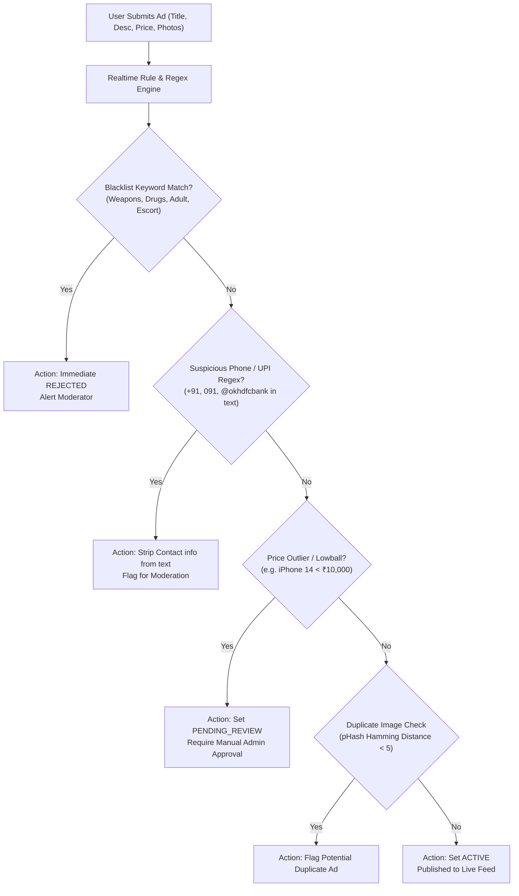

# 06. Security, Anti-Fraud & Compliance Architecture

---

## 1. Overview & Threat Model

Peer-to-peer marketplaces in India operate in an adversarial threat landscape. Common vectors include:
1. **Advance Payment / QR Code Scams**: Fraudulent sellers listing high-value items (e.g. brand new iPhone at 50% market price) demanding advance courier fees via UPI QR code.
2. **Automated Scraping & Harassment**: Web scrapers crawling listings to harvest seller phone numbers for unsolicited telemarketing.
3. **Account Takeover & OTP Interception**: Credential stuffing and brute-force attacks on SMS OTP endpoints.
4. **Prohibited Listings & Counterfeits**: Banned fauna (pets/wildlife trade), illegal drugs, prescription medications, or counterfeit luxury goods.

---

## 2. OWASP Top 10 Mitigation Checklist

| OWASP Risk | Platform Vulnerability Context | Engineered Mitigation Strategy |
| :--- | :--- | :--- |
| **A01: Broken Access Control** | User editing another user's ad; unauthorized access to admin endpoints. | Express `requireAuth` verifies the active user and `requireRole` protects admin/moderation/category routes. Sensitive admin mutations write audit logs. |
| **A02: Cryptographic Failures** | Token theft, plaintext password or OTP storage. | Passwords hashed using `bcrypt` (12 rounds). Sensitive OTP hashes stored with SHA-256 with 5-minute expiry. JWT signed with RS256/HS256 with 15-minute lifespan. Strict HTTPS via TLS 1.3. |
| **A03: Injection** | SQL injection via search filters; NoSQL / PostGIS spatial injection. | Prisma parameterized queries used exclusively; dynamic `$queryRaw` PostGIS queries use strict Prisma template tags `Prisma.sql` preventing SQL string interpolation. |
| **A04: Insecure Design** | Unrestricted phone number visibility enabling bulk harvesting. | Seller phone numbers masked by default. Revealing requires authenticated login, captcha challenge on high-frequency users, and a hard rate-limit of 15 views/day. |
| **A05: Security Misconfiguration** | S3 bucket public write access; permissive CORS headers. | S3 buckets private by default with no public write. S3 Presigned PUT URLs issued with 10-minute expiry and strict content-type constraints (`image/jpeg`, `image/png`, `image/webp`). |
| **A06: Vulnerable Components** | Outdated npm packages. | Automated daily `npm audit` and Dependabot scanning in CI/CD pipeline. Docker images built on minimal `node:20-alpine` base. |
| **A07: Identification & Auth Failures** | OTP brute forcing; repeated admin login; refresh token re-use. | OTP session expiry/attempt tracking, rate-limited admin login, hashed refresh tokens and refresh-token rotation. Production admin access must use `ADMIN_PASSWORD_HASH`. |
| **A08: Software & Data Integrity** | Malicious file upload (SVG XSS or shell scripts masquerading as images). | Image upload validation checks MIME types using magic-byte headers, strictly disallows SVG/HTML, and routes all uploads through Sharp to re-encode into clean WebP, stripping all EXIF GPS metadata. |
| **A09: Security Logging & Monitoring** | Undetected fraud attacks or unauthorized admin actions. | Dedicated `audit_logs` table records failed/admin login, logout, denied authorization, ad status/delete, moderation and category mutations. |
| **A10: Server-Side Request Forgery (SSRF)** | Remote image upload or webhook callbacks. | No user-supplied URLs fetched server-side in v1. Media upload is client-to-S3 direct. |

---

## 3. Rate Limiting Matrix (Redis Sliding Window)

Implemented via `@nestjs/throttler` backed by Redis:

| Endpoint Group | Key Identifier | Threshold Limits | Breach Action |
| :--- | :--- | :--- | :--- |
| **OTP Send** (`POST /auth/otp/send`) | Phone Number + IP | 3 requests / 5 minutes; 5 requests / 1 hour | HTTP 429 Too Many Requests; 15-minute cooldown |
| **OTP Verify** (`POST /auth/otp/verify`) | Phone Number | 3 attempts per session | Session invalidated immediately; new OTP required |
| **Public Search** (`GET /ads`) | IP Address | 120 requests / 1 minute | HTTP 429; Cloudflare Captcha challenge |
| **Post Ad** (`POST /ads`) | User ID | 10 new ads / 24 hours (Free tier) | HTTP 429; Admin review trigger |
| **Reveal Phone** (`GET /ads/:id/seller-phone`) | User ID + IP | 15 reveals / 24 hours | Blocked for 24h; flagged in audit log |
| **Chat Messages** (`WS: sendMessage`) | User ID | 30 messages / 1 minute | Socket emit `rateLimitExceeded`; temporary 2-min mute |

---

## 4. Anti-Fraud & Spam Prevention Engine

### 4.1 Chat Window Anti-Fraud Guardrails
- **In-Chat UPI & QR Code Interception**: Real-time regex filters detect UPI IDs (`[a-zA-Z0-9.\-_]{2,256}@[a-zA-Z]{2,64}`) and URL payment links sent by sellers within the first 3 messages. A high-visibility warning box appears:
  > *"Caution: Never make an advance payment or scan any QR code. Inspect the item in person before making payment."*
- **Block & Silence**: When User A blocks User B, existing conversations display "User is unavailable" and subsequent message emissions are silently dropped with zero database writes.

---

## 5. Input Validation & File Upload Security

1. **DTO-Level Validation**:
   - Every NestJS controller enforces strict `ValidationPipe({ whitelist: true, forbidNonWhitelisted: true, transform: true })`.
   - String inputs sanitized using `validator.escape()` to neutralize HTML/XSS payloads.
2. **Media Pipeline Security**:
   - Presigned URLs are generated with explicit content length caps (maximum 10MB per image).
   - Sharp processing pipeline strips all embedded EXIF metadata (GPS coordinates, camera serial numbers) to protect seller home location privacy.
   - Images are normalized and re-encoded into WebP format, mitigating polyglot file attacks.

---

## 6. Indian DPDP Act (Digital Personal Data Protection) Compliance

OLX ORBIT aligns with the principles of the **Indian Digital Personal Data Protection Act, 2023**:

1. **Notice & Consent**:
   - Explicit consent checkbox during mobile OTP registration for collecting phone number and coarse location data.
2. **Purpose Limitation & Data Minimization**:
   - User location is stored at the locality/city level. Precise GPS coordinates are only used at the moment of posting to calculate radius distances, never broadcast publicly.
3. **Right to Erasure & Account Deletion**:
   - Users can trigger `/user/delete-account`. This initiates a 14-day grace period, followed by permanent anonymization of personal identifiers (`phone_number`, `email`, `name` replaced with `Deleted User [UUID]`, profile photo deleted from S3).
4. **Data Localization**:
   - PostgreSQL and S3 object storage instances are hosted in AWS `ap-south-1` (Mumbai) data centers to ensure Indian sovereign data residency.

---

## 7. Role-Based Access Control (RBAC) Matrix

| Entity & Action | Guest | User (Buyer/Seller) | Moderator | Admin |
| :--- | :---: | :---: | :---: | :---: |
| **Browse / Search Ads** | Allowed | Allowed | Allowed | Allowed |
| **Post / Edit Own Ad** | Denied | Allowed | Allowed | Allowed |
| **Reveal Seller Phone** | Denied | Allowed (Rate Limited) | Allowed | Allowed |
| **Send Chat Message** | Denied | Allowed | Allowed | Allowed |
| **Review / Flag Ad** | Denied | Allowed | Allowed | Allowed |
| **Approve / Reject Any Ad** | Denied | Denied | Allowed | Allowed |
| **Ban / Suspend User** | Denied | Denied | Denied | Allowed |
| **Manage Categories & Attributes** | Denied | Denied | Denied | Allowed |
| **View Audit Logs & System Metrics** | Denied | Denied | Denied | Allowed |

---

## 8. Open Questions & Assumptions
- **Assumed**: Identity verification (Aadhaar / DigiLocker KYC) is not mandatory for general users in v1, but could be introduced for high-value car/property sellers in v2.
- **Question**: Should we retain banned user phone number hashes permanently in a separate blacklist table to prevent re-registration with fresh OTPs? *(Current assumption: Yes, SHA-256 phone hash preserved indefinitely in `banned_identifiers`).*
