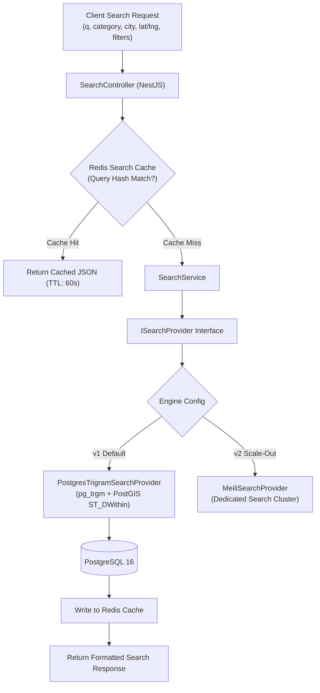
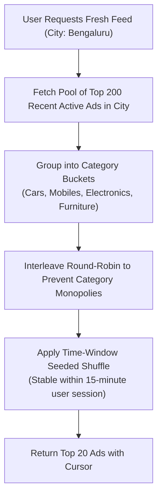

# 07. Search Engine Architecture & Recommendation Algorithms

---

## 1. Overview & Search Architecture

Discovery is the primary driver of marketplace engagement. The search subsystem is engineered with a **Provider Abstraction Pattern** (`ISearchProvider`), isolating the API and business logic from the underlying indexing engine.



---

## 2. Pluggable Search Provider Interface

The `ISearchProvider` contract in `apps/api/src/modules/search/search-provider.interface.ts`:

```typescript
export interface SearchFilterCriteria {
  query?: string;
  categoryId?: string;
  categorySlug?: string;
  locationId?: string;
  citySlug?: string;
  coordinates?: {
    latitude: number;
    longitude: number;
    radiusKm: number;
  };
  minPrice?: number;
  maxPrice?: number;
  attributes?: Record<string, string | number | boolean>;
  sortBy?: 'relevance' | 'newest' | 'price_asc' | 'price_desc';
  cursor?: string;
  limit: number;
}

export interface SearchResultItem {
  id: string;
  title: string;
  slug: string;
  price: number;
  isNegotiable: boolean;
  featuredType: string | null;
  thumbnailUrl: string;
  locationName: string;
  attributesSummary: Record<string, any>;
  score: number;
  createdAt: string;
}

export interface SearchResultEnvelope {
  items: SearchResultItem[];
  nextCursor?: string;
  hasMore: boolean;
  totalEstimatedCount: number;
  facets?: Record<string, Record<string, number>>;
}

export interface ISearchProvider {
  search(criteria: SearchFilterCriteria): Promise<SearchResultEnvelope>;
  indexAd(adId: string): Promise<void>;
  removeAd(adId: string): Promise<void>;
  suggest(query: string, cityId?: string): Promise<string[]>;
}
```

---

## 3. PostgreSQL v1 Implementation (`PostgresTrigramSearchProvider`)

### 3.1 Composite SQL Query Construction
In v1, search queries execute against PostgreSQL leveraging `pg_trgm` GIN indexes and PostGIS `ST_DWithin`:

```sql
SELECT 
  a.id,
  a.title,
  a.slug,
  a.price,
  a.is_negotiable,
  a.created_at,
  a.attributes_cache,
  img.thumbnail_url,
  loc.name AS location_name,
  fa.type AS boost_type,
  -- Combined Scoring Formula
  (
    -- 1. Keyword Relevance (pg_trgm similarity 0.0 to 1.0) * Weight 40
    (similarity(a.title, :searchQuery) * 40.0) +
    -- 2. Freshness Score (Decays linearly over 30 days) * Weight 25
    (GREATEST(0, (1.0 - (EXTRACT(EPOCH FROM (NOW() - a.created_at)) / (30 * 86400.0)))) * 25.0) +
    -- 3. Proximity Score (1.0 at origin, decays over radius) * Weight 20
    (CASE 
      WHEN :userLat IS NOT NULL THEN 
        GREATEST(0, (1.0 - (ST_Distance(a.location_coords, ST_SetSRID(ST_MakePoint(:userLng, :userLat), 4326)::geography) / (:radiusMeters)))) * 20.0
      ELSE 10.0 
    END) +
    -- 4. Featured / Boost Multiplier * Weight 15
    (CASE WHEN fa.status = 'ACTIVE' THEN 15.0 ELSE 0.0 END)
  ) AS ranking_score

FROM ads a
LEFT JOIN ad_images img ON img.ad_id = a.id AND img.is_cover = true
LEFT JOIN locations loc ON loc.id = a.location_id
LEFT JOIN featured_ads fa ON fa.ad_id = a.id AND fa.status = 'ACTIVE' AND fa.ends_at > NOW()

WHERE a.status = 'ACTIVE'
  -- Geo-radius filter (if lat/lng supplied)
  AND (
    :userLat IS NULL OR 
    ST_DWithin(a.location_coords, ST_SetSRID(ST_MakePoint(:userLng, :userLat), 4326)::geography, :radiusMeters)
  )
  -- Keyword filter (Trigram threshold > 0.15)
  AND (
    :searchQuery IS NULL OR 
    (a.title % :searchQuery OR a.description % :searchQuery)
  )
  -- Category & Price Filters
  AND (:categoryId IS NULL OR a.category_id = :categoryId)
  AND (:minPrice IS NULL OR a.price >= :minPrice)
  AND (:maxPrice IS NULL OR a.price <= :maxPrice)

ORDER BY 
  (CASE WHEN :sortBy = 'newest' THEN a.created_at END) DESC,
  (CASE WHEN :sortBy = 'price_asc' THEN a.price END) ASC,
  (CASE WHEN :sortBy = 'price_desc' THEN a.price END) DESC,
  ranking_score DESC,
  a.id DESC

LIMIT :limit;
```

---

## 4. Multi-Factor Ranking Formula

When sorting by **Relevance** (Default search mode), results are ranked by a composite formula scored out of 100 points:

$$\text{Final Score} = S_{\text{relevance}} + S_{\text{freshness}} + S_{\text{proximity}} + S_{\text{boost}}$$

1. **Relevance ($S_{\text{relevance}}$ — Max 40 pts)**:
   - Evaluates string similarity between user query and `title` (weight: 0.8) and `description` (weight: 0.2) using trigram token matching. Exact word matches receive full weight.
2. **Freshness ($S_{\text{freshness}}$ — Max 25 pts)**:
   - Linearly decays from 25 points on Day 0 down to 0 points on Day 30:
     $$S_{\text{freshness}} = 25 \times \max\left(0, 1 - \frac{\text{Age in Days}}{30}\right)$$
3. **Proximity ($S_{\text{proximity}}$ — Max 20 pts)**:
   - For geo-located queries, ads closer to the user receive higher rank:
     $$S_{\text{proximity}} = 20 \times \max\left(0, 1 - \frac{\text{Distance in KM}}{\text{Radius in KM}}\right)$$
4. **Boost / Featured Ad ($S_{\text{boost}}$ — Max 15 pts)**:
   - Verified active featured promotions receive a flat 15-point priority bump, ensuring they naturally surface near the top without entirely displacing highly relevant organic items.

---

## 5. "Fresh Recommendations" Feed Logic

The home page feed (`GET /ads?feed=fresh&citySlug=bengaluru`) delivers an engaging, personalized mix of recent listings rather than a flat chronological list:



### Feed Diversity Rules
1. **Category Clustering Prevention**: No more than 2 consecutive ads from the same leaf category are served in a row.
2. **Seller Throttling**: A single seller (e.g. high-volume used phone dealer) cannot occupy more than 1 ad slot per 10 items in the public recommendation stream.

---

## 6. Caching Strategy & Invalidation Policy

Implemented via **Redis** memory store with key hashing:

| Cache Level | Cache Key Pattern | TTL | Invalidation Trigger |
| :--- | :--- | :--- | :--- |
| **Search Query Cache** | `search:hash(queryCriteria)` | 60 seconds | Natural TTL expiration (short duration allows high query reuse while tolerating minor sync delays) |
| **Autosuggest Cache** | `suggest:cityId:prefix` | 1 hour | Daily BullMQ index refresh |
| **Home Fresh Feed** | `feed:cityId:cursor` | 90 seconds | Natural TTL expiration |
| **Category Tree** | `categories:all` | 24 hours | Admin Category CRUD action explicitly calls `redis.del('categories:all')` |

---

## 7. Open Questions & Assumptions
- **Assumed**: Search volume in v1 will be handled comfortably by PostgreSQL with connection pooling (PgBouncer) up to ~500,000 active listings.
- **Question**: When swapping to Meilisearch in v2, should we run real-time dual-writing via BullMQ or use a CDC (Change Data Capture) tool like Debezium? *(Current recommendation: BullMQ event-driven synchronization on `AdCreated` / `AdUpdated` / `AdStatusChanged`).*
