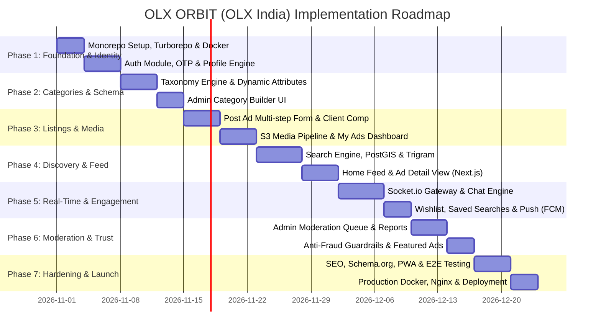

# 09. Implementation Roadmap & Phase-by-Phase Execution Plan

---

## 1. Roadmap Overview & Timeline

The build plan spans 7 structured phases, moving sequentially from core infrastructure and identity to listing engines, search, real-time messaging, and production deployment.



---

## 2. Phase-by-Phase Execution Details

### Phase 1: Monorepo Foundation, Database & Identity
- **Objectives**: Initialize Turborepo (`apps/web`, `apps/admin`, `apps/api`, `packages/database`, `packages/shared`), Docker Compose, PostgreSQL + PostGIS, Redis, Prisma migrations, and Indian mobile OTP authentication.
- **Estimated Effort**: 7 Days
- **Key Deliverables**:
  - Turborepo configuration with strict pnpm workspaces.
  - Prisma schema compiled and migrated with PostGIS extensions.
  - NestJS `AuthModule` supporting Phone OTP (MSG91/Twilio adapter) and JWT refresh token rotation.
  - Next.js auth modal / bottom sheet for mobile login.
- **Acceptance Criteria**:
  - Running `docker compose up` starts PostgreSQL, Redis, and MinIO.
  - User can request an OTP to an Indian mobile number, receive a 6-digit code, verify it, and receive an authenticated session with an HttpOnly refresh cookie.
  - Unauthenticated requests to protected endpoints return standard 401 JSON envelopes.

---

### Phase 2: Taxonomy Engine & Dynamic Category Attributes
- **Objectives**: Implement the nested category hierarchy (Cars, Mobiles, Properties, Jobs, etc.) and the dynamic attribute builder.
- **Estimated Effort**: 7 Days
- **Key Deliverables**:
  - Normalized database schema for `categories` and `category_attributes`.
  - NestJS endpoints for category tree retrieval (cached in Redis).
  - Admin Portal category & dynamic attribute builder UI (adding dropdowns, number inputs, units).
  - Complete seed data for 12 top-level Indian classifieds categories and their attributes.
- **Acceptance Criteria**:
  - `GET /api/v1/categories` returns the complete 3-level taxonomy in < 30ms from Redis.
  - Adding an attribute like "Fuel Type" (Petrol, Diesel, Electric) in the Admin panel immediately reflects in the attribute schema for "Cars".

---

### Phase 3: Post Ad Flow, S3 Media Processing & "My Ads"
- **Objectives**: Build the multi-step guided Ad creation workflow, client-side WebP compression, S3 direct upload, Sharp worker pipeline, and user ad management.
- **Estimated Effort**: 8 Days
- **Key Deliverables**:
  - Next.js Post Ad wizard (`/post-ad`) with dynamic input rendering based on selected leaf category.
  - Direct-to-S3 presigned upload endpoint with MIME validation.
  - BullMQ background worker converting images to WebP thumbnail (`300x300`) and display (`1200x900`) sizes.
  - User "My Ads" dashboard (`/my-ads`) with tabbed statuses (`ACTIVE`, `PENDING_REVIEW`, `SOLD`, `EXPIRED`).
- **Acceptance Criteria**:
  - User can upload up to 12 camera photos; images are auto-compressed on client (< 1.5MB) and processed to WebP by the worker in < 5 seconds.
  - User can mark an active ad as `SOLD`, edit price, or renew an expired ad.

---

### Phase 4: Discovery, Search Engine & Ad Detail Page
- **Objectives**: Implement the PostGIS geo-radial search, PostgreSQL trigram keyword search, dynamic attribute facet filtering, Home Page feed, and SEO-optimized Ad Detail page.
- **Estimated Effort**: 9 Days
- **Key Deliverables**:
  - NestJS `SearchService` implementing `PostgresTrigramSearchProvider`.
  - Next.js Search page (`/search`) with responsive sidebar filters, price slider, and radius dropdown.
  - Home page (`/`) with Hero Banners, Category Grid, and "Fresh Recommendations" feed.
  - Ad detail page (`/ad/[slug]`) with image gallery, specs grid, seller card, and masked phone number reveal.
- **Acceptance Criteria**:
  - Searching "Swift" within "25km of Bengaluru" returns matching results sorted by composite relevance in < 150ms.
  - Ad detail page renders server-side in Next.js with complete OpenGraph metadata and JSON-LD schema.

---

### Phase 5: Real-Time Chat, Wishlist & Notifications
- **Objectives**: Build the 1-on-1 real-time buyer-seller chat system using Socket.io and Redis Pub/Sub, user wishlist, and multi-channel notifications.
- **Estimated Effort**: 8 Days
- **Key Deliverables**:
  - Socket.io gateway with Redis adapter for horizontal scaling.
  - Split-view desktop / full-screen mobile chat UI (`/chat`).
  - Chat features: text, image attachments, typing indicators, delivery receipts, unread counter badges.
  - Wishlist / Favourites (`/favourites`) and Saved Searches with price-drop alerts.
  - FCM push notification triggers for background message delivery.
- **Acceptance Criteria**:
  - Messages sent between buyer and seller appear in real-time (< 200ms) with delivery and read checkmarks.
  - Offline users receive a native web push notification via FCM.

---

### Phase 6: Admin Moderation, Anti-Fraud & Trust
- **Objectives**: Equip the platform with trust, moderation, safety tools, and featured ad promotions.
- **Estimated Effort**: 7 Days
- **Key Deliverables**:
  - Admin Moderation Queue (`/admin/moderation`) with approve/reject actions and rejection reason messaging.
  - User Reporting and Block system (`POST /moderation/reports`, `POST /moderation/blocks`).
  - Automated fraud detection: Phone number stripping in public text, blacklisted keyword auto-rejection, UPI fraud warning banners in chat.
  - Admin-assigned Featured / Elite ad boosts.
- **Acceptance Criteria**:
  - Flagged ads immediately appear in the moderation queue; rejected ads are hidden from public feeds with an explanatory notification sent to the seller.
  - Chat window intercepts UPI IDs and warns users against advance payments.

---

### Phase 7: Hardening, PWA, Testing & Production Deployment
- **Objectives**: Production readiness, automated CI/CD pipeline, PWA manifest, comprehensive Playwright E2E tests, and cloud deployment.
- **Estimated Effort**: 7 Days
- **Key Deliverables**:
  - PWA manifest, service workers, and offline fallback banner.
  - Playwright automated browser test suite covering the post-to-chat happy path.
  - Multi-stage Dockerfiles (`apps/api`, `apps/web`, `apps/admin`) and Nginx reverse proxy configuration.
  - GitHub Actions automated deployment pipeline.
- **Acceptance Criteria**:
  - Google Lighthouse score > 90 across Performance, SEO, and Best Practices.
  - Zero critical security vulnerabilities on `npm audit` and Snyk container scans.
  - Automated deployment successfully brings up the complete stack behind SSL.

---

## 3. Copy-Paste Prompts for Starting Each Phase

### Copy-Paste Prompt: To Start Phase 1
```text
Phase 1 Approval Granted. You are acting as Principal Software Architect and Senior Full-Stack Engineer.
Please execute Phase 1 according to docs/09-IMPLEMENTATION-ROADMAP.md:
1. Initialize the Turborepo monorepo structure with pnpm workspaces: apps/web (Next.js 14+ App Router), apps/admin (Vite React), apps/api (NestJS), packages/database (Prisma), packages/shared (Types/DTOs).
2. Set up docker/docker-compose.yml for local PostgreSQL (with PostGIS), Redis, and MinIO.
3. Apply the complete Prisma schema from docs/03-DATABASE-SCHEMA.md including PostGIS spatial coordinates and Trigram extensions.
4. Implement the AuthModule in apps/api supporting Phone OTP send/verify (with MSG91/Twilio adapter and mock mode for dev), JWT token issuance, and refresh token rotation with HttpOnly cookies.
5. Create the responsive Phone OTP Login Modal in apps/web.
Ensure all code compiles, runs with tests, and meets the acceptance criteria in docs/09-IMPLEMENTATION-ROADMAP.md.
```

### Copy-Paste Prompt: To Start Phase 2
```text
Phase 2 Approval Granted. Please execute Phase 2 according to docs/09-IMPLEMENTATION-ROADMAP.md:
1. Build the CategoryModule in apps/api with nested hierarchical queries (cached in Redis).
2. Implement dynamic attribute schema retrieval based on leaf category ID.
3. Seed the database with the complete 12 top-level Indian classifieds categories (Cars, Mobiles, Properties, Electronics, etc.) and their specific dynamic attributes.
4. In apps/admin, build the Category & Dynamic Attribute Builder UI allowing admins to add/modify categories, attribute types (SELECT, NUMBER, TEXT), and units.
Ensure API responses match docs/04-API-SPEC.md and meet Phase 2 acceptance criteria.
```

### Copy-Paste Prompt: To Start Phase 3
```text
Phase 3 Approval Granted. Please execute Phase 3 according to docs/09-IMPLEMENTATION-ROADMAP.md:
1. Implement the multi-step Post Ad workflow in apps/web (/post-ad) with dynamic attribute form rendering.
2. Build client-side image compression (WebP, max 1600px, < 1.5MB) and direct S3 presigned PUT URL upload flow.
3. Set up the BullMQ media worker to process uploaded images into 300x300 thumbnails and 1200x900 display sizes using Sharp.
4. Build the user 'My Ads' dashboard in apps/web (/my-ads) with tabbed statuses (Active, Pending, Sold, Expired) and actions (Mark as Sold, Renew, Edit).
Ensure all code compiles and meets Phase 3 acceptance criteria.
```

### Copy-Paste Prompt: To Start Phase 4
```text
Phase 4 Approval Granted. Please execute Phase 4 according to docs/09-IMPLEMENTATION-ROADMAP.md:
1. Implement the SearchService in apps/api using PostgresTrigramSearchProvider with PostGIS ST_DWithin radius filtering and the multi-factor ranking formula from docs/07-SEARCH-AND-RECOMMENDATION.md.
2. Build the Next.js Home page (/) with Location selector, Hero banners, Category icon grid, and 'Fresh recommendations' feed.
3. Build the Search Results page (/search) with keyword search, autosuggest, dynamic facet filters, and sorting.
4. Build the server-rendered Ad Detail page (/ad/[slug]) with image gallery, specs table, seller card, similar ads, and masked phone reveal button.
Ensure pages satisfy Core Web Vitals and meet Phase 4 acceptance criteria.
```

### Copy-Paste Prompt: To Start Phase 5
```text
Phase 5 Approval Granted. Please execute Phase 5 according to docs/09-IMPLEMENTATION-ROADMAP.md:
1. Implement the ChatModule in apps/api using Socket.io gateway backed by Redis adapter for horizontal scaling.
2. Build the responsive real-time chat interface in apps/web (/chat) supporting split desktop and full-screen mobile views.
3. Implement chat features: text, image sharing, typing indicators, read receipts, and unread count badges in the navbar.
4. Build the Wishlist / Favourites toggle and Saved Searches alert module with FCM push notification triggers.
Ensure real-time events match docs/04-API-SPEC.md and meet Phase 5 acceptance criteria.
```

### Copy-Paste Prompt: To Start Phase 6
```text
Phase 6 Approval Granted. Please execute Phase 6 according to docs/09-IMPLEMENTATION-ROADMAP.md:
1. Build the Admin Moderation Queue in apps/admin (/admin/moderation) with review, approve, and reject capabilities.
2. Implement User Reporting and Block functionality (POST /moderation/reports, POST /moderation/blocks).
3. Implement automated fraud guardrails: phone number masking, UPI ID warnings in chat, and blacklisted keyword auto-rejection.
4. Implement Featured / Boost ad assignment in the admin panel.
Ensure security controls match docs/06-SECURITY-AND-COMPLIANCE.md and meet Phase 6 acceptance criteria.
```

### Copy-Paste Prompt: To Start Phase 7
```text
Phase 7 Approval Granted. Please execute Phase 7 according to docs/09-IMPLEMENTATION-ROADMAP.md:
1. Implement SEO optimizations in apps/web: dynamic meta tags, OpenGraph images, schema.org Product and Breadcrumb JSON-LD, sitemap.xml, and PWA service workers.
2. Write Playwright end-to-end tests for the complete user journey: Auth -> Post Ad -> Search -> Chat.
3. Create production Dockerfiles for apps/api, apps/web, and apps/admin with Nginx reverse proxy configuration.
4. Set up the GitHub Actions CI/CD pipeline for automated testing and staging deployment.
Ensure all acceptance criteria and production benchmarks are verified.
```
