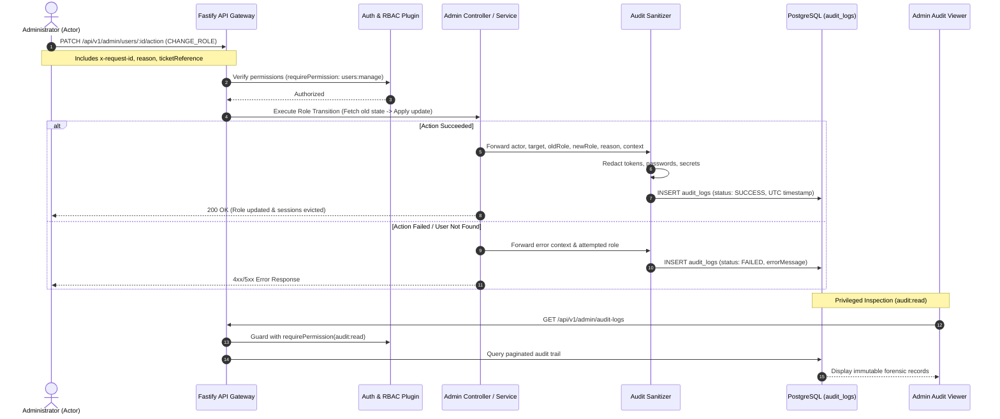
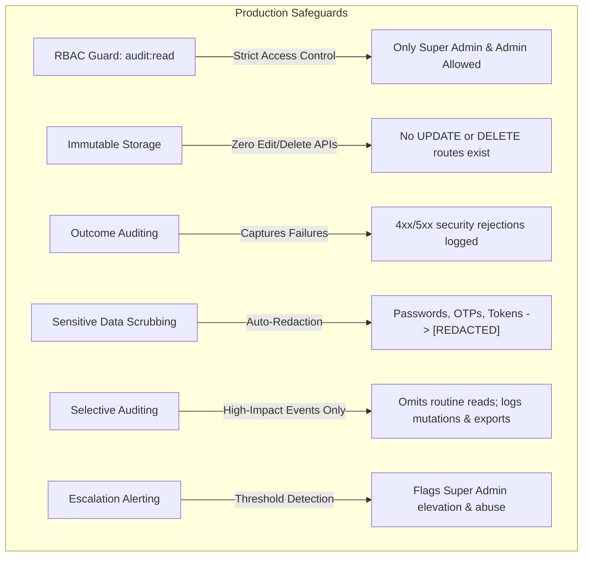

# Enterprise Security Audit Logging & Compliance Specification

## 1. Overview & Working Principle

The audit logging subsystem provides an **append-only, tamper-evident forensic trail** of all identity, authorization, access control, and high-impact administrative lifecycle events in the marketplace platform.

### Core Architecture Principles
1. **Actor Attribution**: Every administrative mutation records the authenticated actor's identity, role, and source context.
2. **Target Traceability**: Explicitly binds every change to the target user account, classified listing, or resource affected.
3. **Before & After State Capture**: Captures both previous (`oldData`) and current (`newData`) states for full non-repudiation.
4. **Outcome Transparency**: Logs both successful operations and rejected/failed execution attempts with specific failure reasons.
5. **Zero Data Tampering (Immutability)**: Audit logs cannot be modified, edited, or deleted through application API endpoints.

---

## 2. Forensic Audit Log Pipeline



---

## 3. Audit Log Schema & Field Specifications

Every audit record in `audit_logs` encapsulates the following standard forensic fields:

| Field | Type | Description | Example |
| :--- | :--- | :--- | :--- |
| `id` | `UUID (VarChar 36)` | Unique immutable log record identifier | `9b1deb4d-3b7d-4bad-9bdd-2b0d7b3dcb6d` |
| `userId` | `VarChar 36 (Nullable)` | Actor ID: Authenticated operator who initiated the change | `usr_superadmin_01` |
| `action` | `VarChar 100` | Standardized uppercase action verb event name | `USER_ROLE_CHANGE`, `STAFF_INVITATION_SENT` |
| `entityType` | `VarChar 50` | High-level resource category affected | `USER`, `INVITATION`, `AD`, `AUTH` |
| `entityId` | `VarChar 50` | Primary key identifier of the affected target | `usr_target_operator_42` |
| `oldData` | `JSONB` | Serialized target state prior to modification | `{"role": "MODERATOR", "status": "ACTIVE"}` |
| `newData` | `JSONB` | Serialized target state, outcome, reason, and security context | See structured format below |
| `ipAddress` | `VarChar 45` | Client IP address with proxy forwarding resolution | `103.21.244.12` |
| `userAgent` | `VarChar 500` | Browser or CLI client user-agent string | `Mozilla/5.0 ... Chrome/130.0` |
| `createdAt` | `Timestamp (UTC)` | Authoritative database UTC timestamp | `2026-11-04T08:45:00.120Z` |

---

## 4. Role Change Audit Specification

When an administrator promotes, demotes, or alters a staff role, the audit entry records:

```json
{
  "action": "USER_ROLE_CHANGE",
  "entityType": "USER",
  "entityId": "usr_target_operator_42",
  "oldData": {
    "role": "MODERATOR",
    "status": "ACTIVE",
    "capabilities": ["can_buy", "can_sell"],
    "email": "operator.sneha@olx.in"
  },
  "newData": {
    "role": "ADMIN",
    "status": "ACTIVE",
    "capabilities": ["can_buy", "can_sell"],
    "email": "operator.sneha@olx.in",
    "status": "SUCCESS",
    "reason": "Promoted to Regional Admin to oversee North Zone classifieds",
    "ticketReference": "SEC-8821",
    "requestId": "req-8f92-9901-ab42",
    "timestampUtc": "2026-11-04T08:45:00.120Z",
    "actor": {
      "role": "SUPER_ADMIN",
      "email": "rahul@gmail.com"
    },
    "_alert": "HIGH_SEVERITY_SUPER_ADMIN_CHANGE"
  }
}
```

### Exact Checklist of Recorded Data for Role Changes
1. **Who Initiated the Change**: Actor user ID, email address, and active role.
2. **Which User Was Affected**: Target user ID, account email, and profile name.
3. **Old Role and New Role**: Distinct `oldData.role` and `newData.role` for direct visual diffing.
4. **Whether Action Succeeded or Failed**: Explicit `status: "SUCCESS"` or `status: "FAILED"`.
5. **When It Happened**: Exact ISO UTC timestamp (`timestampUtc`) and database timestamp (`createdAt`).
6. **Request ID & Security Context**: Unique correlation ID (`requestId`), Client IP (`ipAddress`), and User Agent (`userAgent`).
7. **Optional Reason & Ticket Reference**: Auditor context (`reason`) and issue tracking reference (`ticketReference`).
8. **Sensitive Escalation Alert**: Automatically flagged with `_alert: "HIGH_SEVERITY_SUPER_ADMIN_CHANGE"` whenever Super Admin elevation is performed.

---

## 5. Production Safeguards



### Safeguard Rules & Policies

1. **Dedicated Permission (`audit:read`)**:
   - Access to `/api/v1/admin/audit-logs` is strictly restricted to roles with the `audit:read` granular permission (`SUPER_ADMIN` and `ADMIN`).
   - Customer Support, Content Managers, Moderators, and standard Users receive `403 Forbidden`.

2. **Application-Level Immutability**:
   - The application provides **no API routes** for updating (`PUT`/`PATCH`) or deleting (`DELETE`) audit records.
   - Any HTTP request attempting to mutate audit logs returns `404 Route Not Found`.

3. **Logging of Failed Sensitive Actions**:
   - Attacks, unauthorized elevation attempts, and invalid parameter submissions are caught in try/catch blocks and recorded with `status: "FAILED"` along with error reasons.

4. **Structured UTC Events**:
   - All timestamps are generated and stored in UTC standard format (`ISO 8601`) to prevent timezone drift across distributed nodes.

5. **Sensitive Read and Export Auditing**:
   - Routine classified searches and list paginations do not generate database audit rows.
   - High-privilege access—such as exporting forensic audit archives (`AUDIT_ARCHIVE_EXPORTED`) or accessing bulk user directories—is logged.

6. **Automated Alert Flags**:
   - Actions elevating accounts to `SUPER_ADMIN` or revoking root credentials automatically populate `_alert: "HIGH_SEVERITY_SUPER_ADMIN_CHANGE"`.

7. **Retention Policies & Backups**:
   - Production database retention recommended policy: minimum 365 days hot storage in PostgreSQL.
   - Cold storage backup: Daily automated streaming of audit records to encrypted, write-once-read-many (WORM) storage (e.g. AWS S3 Glacier with Object Lock or Google Cloud Storage Bucket Lock) for regulatory and statutory compliance.

