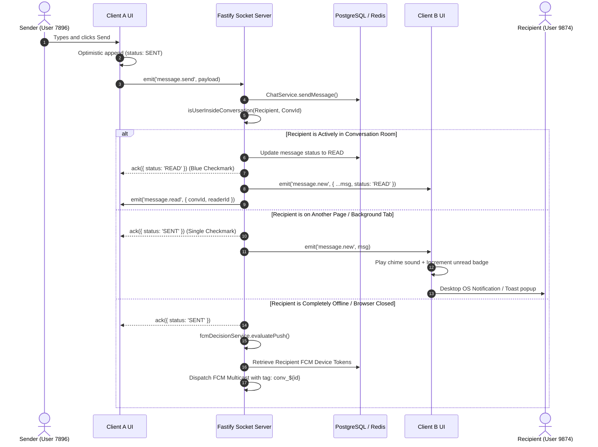
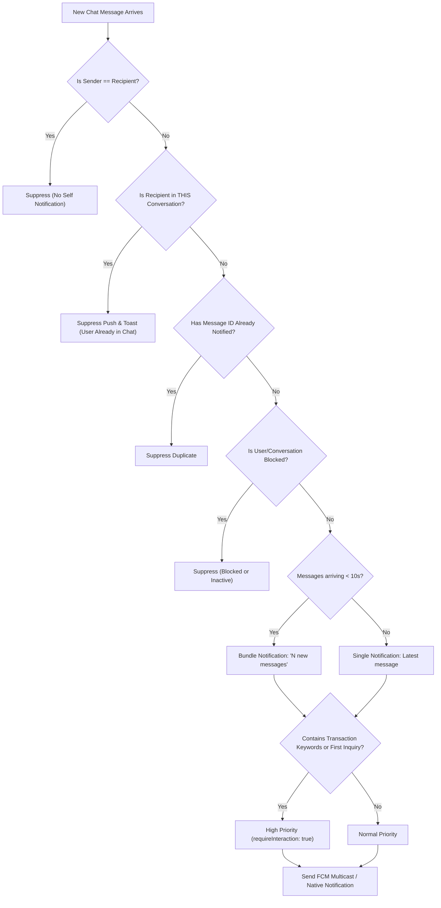
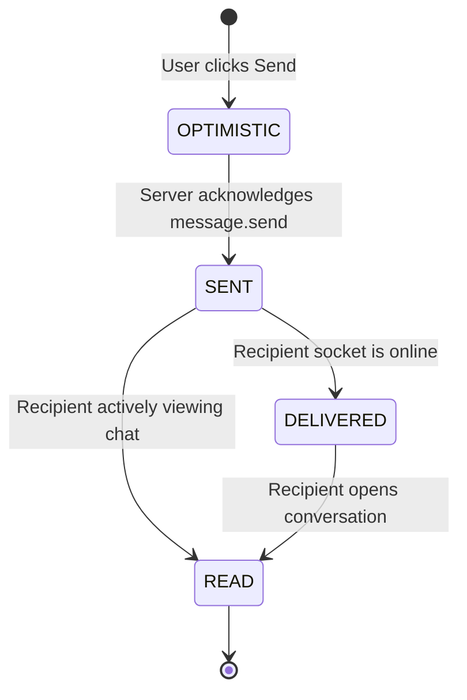

# OLX Chat & Push Notification Architecture

This document describes the real-time messaging architecture, read receipts, and action-required push notification decision engine.

---

## 1. System Architecture Overview

```mermaid
flowchart TD
    Sender["Client A (Sender)"]
    Server["Fastify Backend + Socket.IO"]
    Receiver["Client B (Recipient)"]
    FCM["Google Firebase Cloud Messaging (FCM)"]
    DB[("PostgreSQL + Redis")]

    Sender -->|"message.send (WebSocket)"| Server
    Server -->|"DB Persist + Deduplication"| DB
    Server -->|"isUserInsideConversation check"| DB

    alt Recipient is Inside Conversation
        Server -->|"message.new"| Receiver
        Server -->|"Direct Status: READ"| Sender
    else Recipient is Outside Conversation / Offline
        Server -->|"Evaluate Action Decision"| Server
        Server -->|"sendChatMessagePush"| FCM
        FCM -->|"WebPush / Background SW"| Receiver
    end
```

---

## 2. Real-Time Chat & Read Receipts Flow



---

## 3. Action-Required Push Notification Decision Engine



---

## 4. Message Status Lifecycle



- **SENT (`✓`)**: Stored in DB, dispatched from sender.
- **DELIVERED (`✓✓` Gray)**: Recipient socket is online and received payload.
- **READ (`✓✓` Cyan/Blue `#53bdeb`)**: Recipient has opened/viewed the thread.

---

## 5. Security & Credential Management

1. **Zero Hardcoded Secrets**:
   - All client Firebase configuration is loaded dynamically via environment variables (`import.meta.env.VITE_FIREBASE_*`).
   - Service workers (`sw.js`, `firebase-messaging-sw.js`) receive configuration via URL parameters or dynamic backend endpoint (`/api/v1/notifications/firebase-client-config`).
2. **Service Account Isolation**:
   - `*-firebase-adminsdk-*.json` is protected in `.gitignore`.
   - Never committed to git history.
3. **Environment Setup**:

### Client (`apps/client/.env`)
```env
VITE_API_URL=http://localhost:5000/api/v1
VITE_SOCKET_URL=http://localhost:5000
VITE_FIREBASE_API_KEY=your_api_key
VITE_FIREBASE_AUTH_DOMAIN=your_project.firebaseapp.com
VITE_FIREBASE_PROJECT_ID=your_project_id
VITE_FIREBASE_STORAGE_BUCKET=your_project.firebasestorage.app
VITE_FIREBASE_MESSAGING_SENDER_ID=your_sender_id
VITE_FIREBASE_APP_ID=your_app_id
VITE_FIREBASE_VAPID_KEY=your_public_vapid_key
```

### Server (`apps/server/.env`)
```env
FIREBASE_SERVICE_ACCOUNT_PATH=gen-lang-client-0067863163-firebase-adminsdk-fbsvc-3a9115427b.json
FIREBASE_API_KEY=your_api_key
FIREBASE_AUTH_DOMAIN=your_project.firebaseapp.com
FIREBASE_PROJECT_ID=your_project_id
FIREBASE_STORAGE_BUCKET=your_project.firebasestorage.app
FIREBASE_MESSAGING_SENDER_ID=your_sender_id
FIREBASE_APP_ID=your_app_id
```
