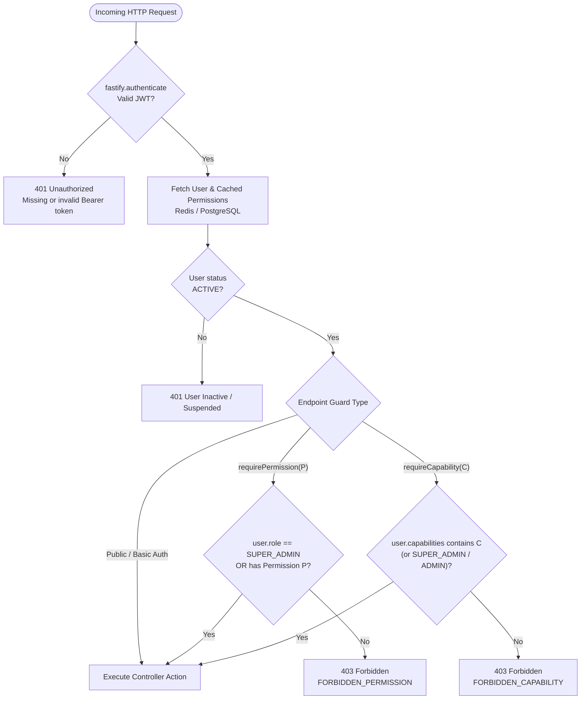
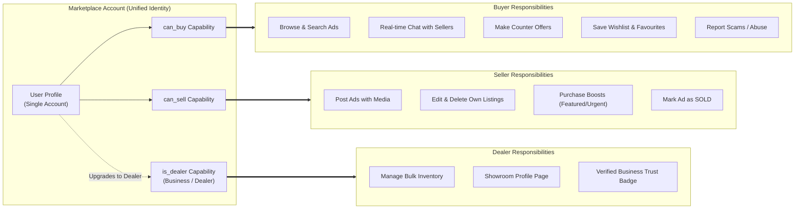

# Role-Based Access Control (RBAC) & Capabilities Specification

This document provides the definitive specification of the **Role-Based Access Control (RBAC)** architecture, **Granular Permissions Matrix**, and **Marketplace Account Capabilities Model** implemented across the OLX Marketplace platform.

---

## Table of Contents

1. [Architectural Principles](#1-architectural-principles)
2. [Admin Panel Roles & Responsibilities](#2-admin-panel-roles--responsibilities)
3. [Granular Permissions Matrix](#3-granular-permissions-matrix)
4. [Marketplace Roles & Capabilities Model](#4-marketplace-roles--capabilities-model)
5. [Authorization Workflow Diagrams (Mermaid)](#5-authorization-workflow-diagrams-mermaid)
   - [Fastify RBAC & Permission Enforcement Engine](#fastify-rbac--permission-enforcement-engine)
   - [Unified Marketplace Account Capabilities Architecture](#unified-marketplace-account-capabilities-architecture)
6. [API Guard Implementations & Usage](#6-api-guard-implementations--usage)
7. [Admin Management & Capability Overrides](#7-admin-management--capability-overrides)

---

## 1. Architectural Principles

The authorization layer enforces modern security and marketplace ergonomics:

### A. Principle of Least Privilege
No role receives broad, blanket administrative rights. Administrative powers are decomposed into fine-grained permissions (e.g., `payments:refund`, `listings:approve`, `settings:manage`).

### B. Strict Separation of Duties (No Universal Admin)
- **Moderators** approve/reject listings and investigate abuse reports, but **cannot** issue refunds, manage platform settings, or delete user accounts.
- **Finance Admins** control invoices, payment audits, and refunds, but **cannot** approve/reject listings, ban users, or change security settings.
- **Admins** manage operational users, listings, categories, and settings, but **cannot** issue financial refunds or create other administrators (restricted to Finance Admin and Super Admin).
- **Super Admins** hold full system control with wildcard permission (`*`).

### C. Unified Marketplace Account Capabilities
**Buyer and seller are handled through account capabilities rather than separate mutually exclusive roles.**
Every registered user in the marketplace can seamlessly buy AND sell simultaneously without needing separate accounts or role switches:
- Any user with `can_buy` can browse ads, chat in real time, make price offers, and save favourites.
- Any user with `can_sell` can post ads, upload photos, and promote listings.
- If a user violates marketplace selling rules, an administrator can revoke `can_sell` without banning the user, allowing them to continue buying safely.
- Commercial dealers and car/property showrooms are granted the `is_dealer` capability to manage bulk inventory and display verified business badges.

---

## 2. Admin Panel Roles & Responsibilities

| # | Role | Enum Key | Primary Scope | Permitted Actions | Prohibited Actions |
|---|---|---|---|---|---|
| 1 | **Super Admin** | `SUPER_ADMIN` | Full System Control | Unrestricted root access (`*`), manage security settings, grant admin roles, process emergency overrides | None |
| 2 | **Admin** | `ADMIN` | Operational Management | Users, listings, categories, settings, banners, audit logs, operational analytics | Cannot process refunds, cannot provision Super Admins |
| 3 | **Moderator** | `MODERATOR` | Content Moderation | Review and approve/reject listings, investigate reported ads and abusive users | Cannot issue refunds, cannot alter settings, cannot delete accounts |
| 4 | **Customer Support** | `CUSTOMER_SUPPORT` | Support & Inquiries | Review support tickets, inspect user complaints, view listing details and user profile lookups | Cannot modify listings, cannot issue refunds, cannot delete users |
| 5 | **Finance Admin** | `FINANCE_ADMIN` | Revenue & Payments | Inspect transactions, manage payment gateways, process refunds, view invoices and revenue reports | Cannot moderate listings, cannot modify platform settings, cannot ban users |
| 6 | **Content Manager** | `CONTENT_MANAGER` | Editorial & Catalog | Manage taxonomy/categories, custom attributes, promotional banners, announcements | Cannot touch finances, cannot review reports, cannot manage users |
| 7 | **Analyst** | `ANALYST` | Business Intelligence | Read-only analytics, platform metrics, traffic, conversion rates, and reports | Strictly read-only; cannot modify or write any data |

---

## 3. Granular Permissions Matrix

| Permission Key | Description | Super Admin | Admin | Moderator | Customer Support | Finance Admin | Content Manager | Analyst |
|---|---|:---:|:---:|:---:|:---:|:---:|:---:|:---:|
| `settings:read` | Read system settings & configs | ✅ | ✅ | ❌ | ❌ | ❌ | ❌ | ❌ |
| `settings:manage` | Modify system settings & configs | ✅ | ✅ | ❌ | ❌ | ❌ | ❌ | ❌ |
| `admins:manage` | Create, promote or demote admins | ✅ | ❌ | ❌ | ❌ | ❌ | ❌ | ❌ |
| `audit:read` | Inspect system audit trail | ✅ | ✅ | ❌ | ❌ | ❌ | ❌ | ❌ |
| `users:read` | View user profiles and contact info | ✅ | ✅ | ❌ | ✅ | ❌ | ❌ | ❌ |
| `users:manage` | Update user roles or capabilities | ✅ | ✅ | ❌ | ❌ | ❌ | ❌ | ❌ |
| `users:ban` | Suspend or permanently ban users | ✅ | ✅ | ❌ | ❌ | ❌ | ❌ | ❌ |
| `support:read` | Read tickets and user complaints | ✅ | ❌ | ❌ | ✅ | ❌ | ❌ | ❌ |
| `support:manage` | Respond to & close support tickets | ✅ | ❌ | ❌ | ✅ | ❌ | ❌ | ❌ |
| `listings:read` | View ads (including drafts & pending) | ✅ | ✅ | ✅ | ✅ | ❌ | ✅ | ✅ |
| `listings:approve` | Approve ads pending moderation | ✅ | ✅ | ✅ | ❌ | ❌ | ❌ | ❌ |
| `listings:reject` | Reject/quarantine violating ads | ✅ | ✅ | ✅ | ❌ | ❌ | ❌ | ❌ |
| `listings:delete` | Hard delete or archive listings | ✅ | ✅ | ❌ | ❌ | ❌ | ❌ | ❌ |
| `reports:read` | View user reports and flagged items | ✅ | ✅ | ✅ | ✅ | ❌ | ❌ | ✅ |
| `reports:investigate` | Resolve reports and take action | ✅ | ✅ | ✅ | ❌ | ❌ | ❌ | ❌ |
| `categories:manage` | Create/edit categories & dynamic fields | ✅ | ✅ | ❌ | ❌ | ❌ | ✅ | ❌ |
| `banners:manage` | Publish hero banners & announcements | ✅ | ✅ | ❌ | ❌ | ❌ | ✅ | ❌ |
| `announcements:manage`| Post platform notifications | ✅ | ✅ | ❌ | ❌ | ❌ | ✅ | ❌ |
| `payments:read` | Inspect Razorpay orders & transactions | ✅ | ❌ | ❌ | ❌ | ✅ | ❌ | ❌ |
| `payments:refund` | Authorize and execute financial refunds | ✅ | ❌ | ❌ | ❌ | ✅ | ❌ | ❌ |
| `invoices:manage` | Generate invoices and billing reports | ✅ | ❌ | ❌ | ❌ | ✅ | ❌ | ❌ |
| `revenue:read` | View revenue analytics & payouts | ✅ | ❌ | ❌ | ❌ | ✅ | ❌ | ❌ |
| `analytics:read` | View platform usage & GMV metrics | ✅ | ✅ | ❌ | ❌ | ✅ | ❌ | ✅ |

---

## 4. Marketplace Roles & Capabilities Model

Instead of forcing users to choose whether they are a "Buyer" or a "Seller", user access is modeled via **Account Capabilities**:

```typescript
export const AccountCapabilities = {
  CAN_BUY: 'can_buy',        // Browse, chat, make offers, save favourites, report ads
  CAN_SELL: 'can_sell',      // Create, edit, promote, and manage listings
  IS_DEALER: 'is_dealer',    // Manage multiple listings, business profile, dealer badges
} as const;
```

### Marketplace Personas

#### 1. Registered User (Default)
- **Role**: `USER`
- **Capabilities**: `["can_buy", "can_sell"]`
- **Responsibilities**:
  - Browse listings, search with filters, and view contact details.
  - Chat in real time with sellers, propose price offers, and save favourite ads.
  - Post and manage their own classified ads.
  - Report suspicious ads or block abusive users.

#### 2. Casual / Private Seller
- **Role**: `USER`
- **Capabilities**: `["can_buy", "can_sell"]`
- **Responsibilities**:
  - Multi-step ad creation with up to 10 images and dynamic category attributes.
  - Manage ad status (`ACTIVE`, `SOLD`, `ARCHIVED`).
  - Purchase featured spots, urgent badges, and top-of-page boosts.

#### 3. Business Seller / Dealership
- **Role**: `USER`
- **Capabilities**: `["can_buy", "can_sell", "is_dealer"]`
- **Profile**: `accountType = "BUSINESS"` or `"DEALER"`, verified business name and location.
- **Responsibilities**:
  - Bulk listing management and dedicated dealer storefront URL.
  - Business badge and verified seller credentials.
  - Priority search placement and multiple concurrent promoted ads.

#### 4. Restricted Account (Seller Suspended)
- **Role**: `USER`
- **Capabilities**: `["can_buy"]` (Selling revoked by Moderator or Admin due to policy violation).
- **Responsibilities**:
  - Can still browse the marketplace, review past chats, and purchase items.
  - Denied from posting new ads or updating existing ads (`403 FORBIDDEN_CAPABILITY`).

---

## 5. Authorization Workflow Diagrams (Mermaid)

### Fastify RBAC & Permission Enforcement Engine



---

### Unified Marketplace Account Capabilities Architecture



---

## 6. API Guard Implementations & Usage

All guards are configured cleanly as Fastify route `preHandler` hooks.

### Checking Permissions in Routes
```typescript
import { requirePermission } from '../../plugins/auth.plugin';
import { Permissions } from '../../shared/auth/rbac';

// Accessible ONLY to Super Admin and Finance Admin:
fastify.post(
  '/admin/refund',
  { preHandler: [fastify.authenticate, requirePermission(Permissions.PAYMENTS_REFUND)] },
  PaymentsController.processRefund
);

// Accessible to Super Admin, Admin, and Moderator:
fastify.patch(
  '/ads/:id/review',
  { preHandler: [fastify.authenticate, requirePermission(Permissions.LISTINGS_APPROVE, Permissions.LISTINGS_REJECT)] },
  ReportsController.reviewAd
);
```

### Checking Capabilities in Routes
```typescript
import { requireCapability } from '../../plugins/auth.plugin';
import { AccountCapabilities } from '../../shared/auth/rbac';

// Requires can_sell capability:
fastify.post(
  '/ads',
  { preHandler: [fastify.authenticate, requireCapability(AccountCapabilities.CAN_SELL)] },
  ListingsController.create
);

// Requires can_buy capability:
fastify.post(
  '/ads/:id/favourite',
  { preHandler: [fastify.authenticate, requireCapability(AccountCapabilities.CAN_BUY)] },
  FavouritesController.toggle
);
```

---

## 7. Admin Management & Capability Overrides

Administrators with `users:manage` permission can adjust roles and capabilities dynamically via `PATCH /api/v1/admin/users/:id/action`:

### Revoke Selling Privileges
```http
PATCH /api/v1/admin/users/usr_48194029/action
Authorization: Bearer <adminToken>
Content-Type: application/json

{
  "action": "UPDATE_CAPABILITIES",
  "capabilities": ["can_buy"],
  "reason": "Policy violation: misleading ad content"
}
```

### Upgrade Account to Dealership
```http
PATCH /api/v1/admin/users/usr_88291044/action
Authorization: Bearer <adminToken>
Content-Type: application/json

{
  "action": "UPDATE_CAPABILITIES",
  "capabilities": ["can_buy", "can_sell", "is_dealer"]
}
```

### Promote User to Moderator
```http
PATCH /api/v1/admin/users/usr_77219011/action
Authorization: Bearer <superAdminToken>
Content-Type: application/json

{
  "action": "CHANGE_ROLE",
  "role": "MODERATOR"
}
```

When an account action is executed, the user's cached session in Redis (`user:<id>`) is immediately purged, guaranteeing instant authorization updates without waiting for JWT token expiration.

