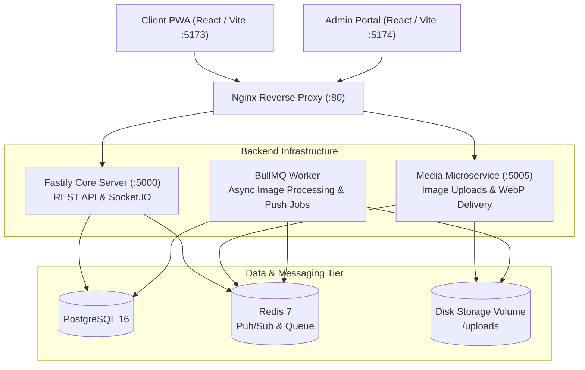
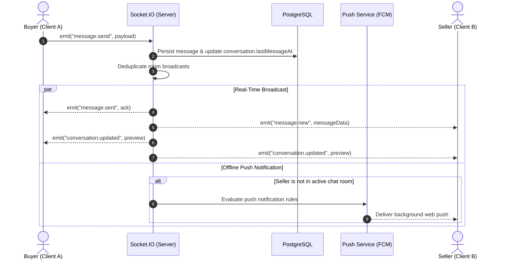
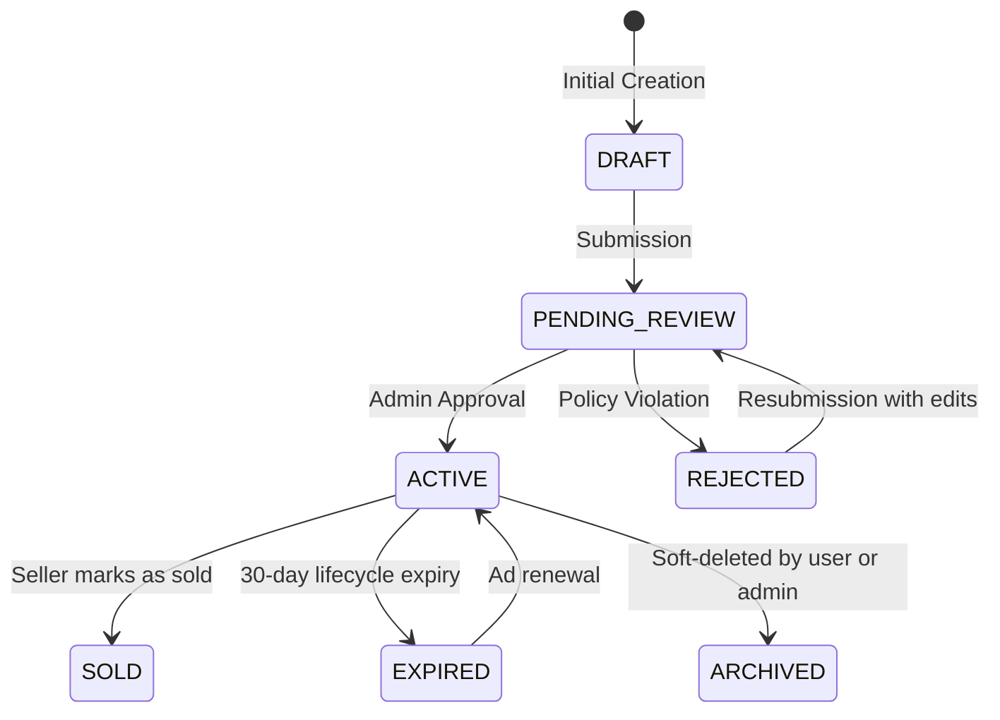

# OLX Orbit / BharatMarket

OLX Orbit is a mobile-first, peer-to-peer classifieds marketplace designed for hyper-local buying and selling across India. Users can discover, search, post classified listings across categories (Cars, Mobiles, Properties, Electronics, Furniture, Bikes, Commercial Vehicles), negotiate via real-time chat, and receive instant push notifications.

This document serves as the comprehensive technical reference for the platform's architecture, monorepo structure, data flow, admin portal, and local development setup.

---

## 1. Project Overview & Capabilities

### Core Features

- **Authentication & Security**: Phone OTP / Email authentication, JWT access/refresh token rotation, rate-limiting, and Role-Based Access Control (RBAC).
- **Listing Discovery & Search**: City and geolocation-based discovery, category hierarchy filtering, full-text search, and price range sorting.
- **Dynamic Category Specifications**: Form schemas dynamically adapt per category (e.g., fuel type, mileage, storage capacity, BHK, property type).
- **Listing Lifecycle & Moderation**: Multi-step post-ad flow with image uploads, automated moderation queue, state transitions (`DRAFT` → `PENDING_REVIEW` → `ACTIVE` / `REJECTED` → `SOLD` / `EXPIRED`).
- **Real-Time Chat & Negotiation**: Socket.IO messaging with Redis clustering adapter, read/delivery receipts, typing indicators, image attachments, and automated fraud/UPI security alerts.
- **Media Optimization Pipeline**: Standalone microservice utilizing Sharp to convert uploaded media into high-performance WebP variants (thumb, card, large).
- **Notifications**: Integrated Firebase Cloud Messaging (FCM) web push notifications and PWA background service worker.
- **Enterprise Admin Portal**: Comprehensive moderation queue, listing approvals, category attribute builder, disk storage monitoring, analytics, and audit logging.

---

## 2. Technology Stack

| Layer | Technologies | Responsibilities |
|---|---|---|
| **Client Frontend** | React 18, TypeScript, Vite, Tailwind CSS, Zustand | Customer PWA interface: search, ad posting, real-time chat, wishlist |
| **Admin Frontend** | React 18, TypeScript, Vite, Tailwind CSS, Lucide | Operational portal: moderation queue, category management, disk metrics |
| **API Backend** | Fastify 5, Node.js, TypeScript | Modular REST API endpoints, Swagger documentation, JWT authentication |
| **Media Service** | Fastify, TypeScript, Sharp, Multer | Media upload validation, WebP compression, local file storage management |
| **Real-Time Layer** | Socket.IO, `@socket.io/redis-adapter` | Multi-server clustered real-time messaging, presence, and chat events |
| **Background Jobs** | BullMQ, Redis 7 | Asynchronous media processing, cleanup tasks, and notification dispatch |
| **Database & Cache** | PostgreSQL 16, Prisma ORM, Redis 7 | Relational persistence, spatial data, caching, and rate limiting |
| **Proxy & Gateways** | Nginx, Docker Compose | Reverse proxy, static asset delivery, SSL termination, environment isolation |

---

## 3. High-Level Architecture



---

## 4. Monorepo Structure

The codebase is organized as a unified monorepo managed with **pnpm workspaces**:

```text
olx/
├── apps/
│   ├── client/                  # Customer-facing React 18 PWA application
│   │   ├── public/              # Service workers, icons, manifest
│   │   └── src/
│   │       ├── features/        # Ads, auth, chat, home, search modules
│   │       ├── components/      # UI components & shared modals
│   │       └── context/         # Auth and layout providers
│   ├── admin/                   # Administrative dashboard & moderation portal
│   │   └── src/
│   │       └── features/        # Moderation, categories, listings, media library
│   ├── server/                  # Core Fastify API & Socket.IO backend
│   │   └── src/
│   │       ├── modules/         # Auth, ads, categories, chat, moderation, admin
│   │       └── integrations/    # Storage adapters, push services
│   ├── media-service/           # Dedicated media upload & optimization microservice
│   └── workers/                 # BullMQ asynchronous background workers
├── packages/
│   ├── database/                # Prisma ORM schema, migrations, and seed scripts
│   └── shared/                  # Common TypeScript interfaces, utilities, and storage providers
├── infrastructure/
│   ├── docker/dev/              # Dockerfiles for development containers
│   └── nginx/                   # Nginx reverse proxy configuration
├── docs/                        # Architectural documentation and specifications
├── docker-compose.dev.yml       # Complete local containerized stack configuration
└── package.json                 # Monorepo root configuration
```

---

## 5. Application Modules

### Customer Frontend (`apps/client`)
- **Home & Catalog**: Hero banner with localized imagery, category ribbons, and algorithmic recommendation feeds.
- **Search & Filters**: Multi-faceted search by keyword, price range, state, city, and dynamic category attributes.
- **Ad Publishing (`PostAdModal`)**: Multi-step wizard supporting client-side image compression, attribute validation, and location tagging.
- **Chat & Messaging (`/chat`)**: WhatsApp-style conversational thread supporting real-time presence indicators, delivered/read checkmarks, image attachments, and quick negotiation prompts.
- **User Dashboard**: Listings manager ("My Ads"), status updates (Mark Sold, Renew), and personal wishlist.

### Administrative Portal (`apps/admin`)
- **Moderation Queue**: Real-time inspection of pending classified advertisements, user reports, and scam detection triggers.
- **Dynamic Category Builder**: Visual interface to construct category trees and define custom input specifications (text, number, boolean, select, multi-select).
- **Media Library & Disk Storage**: Live visualization of disk capacity, storage utilization graphs, and media asset tracking.
- **RBAC & User Governance**: Role assignment (`SUPER_ADMIN`, `ADMIN`, `MODERATOR`, `USER`) and account moderation (suspend, ban).

---

## 6. Real-Time Chat & Notification Architecture

### Message Lifecycle



### Shared Socket Management
The client features a centralized socket singleton ([chatSocket.service.ts](file:///apps/client/src/features/chat/services/chatSocket.service.ts)) to prevent multiple connections per browser tab, eliminate handshake race conditions during React 18 Strict Mode mounts, and preserve connections across route transitions.

---

## 7. Database Design & State Transitions

The database schema is defined in [packages/database/prisma/schema.prisma](../packages/database/prisma/schema.prisma) targeting PostgreSQL 16.

### Ad Status State Diagram



---

## 8. API Endpoints Reference

All REST endpoints are prefixed under `/api/v1`:

| Module | Key Routes | Functionality |
|---|---|---|
| **Auth** | `/auth/otp/send`, `/auth/otp/verify`, `/auth/refresh`, `/auth/me`, `/auth/logout` | Phone OTP login, token rotation, profile identity |
| **Categories** | `/categories`, `/categories/tree`, `/categories/:id/attributes` | Nested categories and dynamic specification schemas |
| **Locations** | `/locations/cities`, `/locations/states` | Geolocation and indexed cities |
| **Listings** | `/ads`, `/ads/:id`, `/ads/:id/status`, `/ads/:id/favourite` | Search, filtering, posting, status transitions |
| **Chat** | `/chat/conversations`, `/chat/conversations/:id/messages`, `/chat/conversations/:id/read` | Inbox management, message history, read status |
| **Media** | `/media/images`, `/media/status/:id` | Image upload, validation, variant processing |
| **Admin** | `/admin/metrics/storage`, `/admin/ads`, `/admin/users`, `/admin/reports` | Operational control, moderation, storage graphs |
| **Health** | `/health` | Liveness and readiness probes |

---

## 9. Local Development Setup

### Prerequisites
- **Node.js**: v20 LTS or higher
- **pnpm**: v9 or higher (`corepack enable pnpm`)
- **Docker Desktop**: For running containerized PostgreSQL, Redis, and services

### Option 1: Running the Complete Docker Stack (Recommended)

1. Clone repository and initialize environment files:
   ```bash
   cp .env.example .env
   ```

2. Start all services in development mode:
   ```bash
   docker compose -f docker-compose.dev.yml up -d
   ```

3. Service Access Endpoints:
   - **Customer Web Application**: [http://localhost:5173](http://localhost:5173)
   - **Admin Portal**: [http://localhost:5174](http://localhost:5174)
   - **Backend API**: [http://localhost:5000](http://localhost:5000)
   - **Swagger Documentation**: [http://localhost:5000/docs](http://localhost:5000/docs)
   - **Media Service**: [http://localhost:5005](http://localhost:5005)

### Option 2: Running Locally via pnpm

1. Install monorepo dependencies:
   ```bash
   pnpm install
   ```

2. Generate Prisma client & apply database schema:
   ```bash
   pnpm --filter @olx/database exec prisma generate
   pnpm --filter @olx/database exec prisma db push
   pnpm --filter @olx/database exec prisma db seed
   ```

3. Launch development servers concurrently:
   ```bash
   pnpm dev
   ```

---

## 10. Related Technical Documentation

For deeper architectural details, consult the specialized documentation files:

- [DEPLOYMENT_STRATEGY.md](DEPLOYMENT_STRATEGY.md): Production container topology, Nginx routing, and Zero-Downtime deployment guide.
- [media.md](media.md): Dedicated media service architecture, WebP processing pipeline, and storage strategy.
- [AUTH_WORKFLOW.md](AUTH_WORKFLOW.md): Fastify OTP authentication lifecycle, Redis session management, and JWT validation.
- [RBAC_WORKFLOW.md](RBAC_WORKFLOW.md): Granular permission sets, user roles, and access control matrices.
- [AD_CREATION_AND_MODERATION_FLOW.md](AD_CREATION_AND_MODERATION_FLOW.md): Detailed classified advertisement lifecycle and moderation mechanics.
