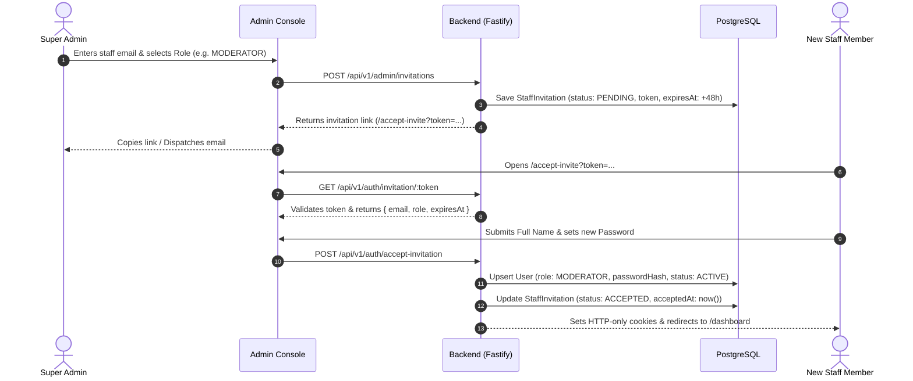

# Staff Invitation Workflow

## 1. Overview & Working Principle

The **Staff Invitation Flow** replaces insecure manual password sharing with a cryptographically signed, single-use onboarding mechanism.

### Core Principles
1. **Zero Shared Passwords**: Admins never create, view, or transmit temporary passwords.
2. **Super Admin Authority**: Only authenticated `SUPER_ADMIN` users have permission to issue staff invitations.
3. **Single-Use Crypto Token**: Each invitation has a 64-character random token expiring in 48 hours.
4. **Instant Self-Activation**: When accepted, the user record is provisioned with the exact assigned role, session cookies are issued, and the token is revoked.

---

## 2. End-to-End Flow



---

## 3. Database Model

```prisma
enum InvitationStatus {
  PENDING
  ACCEPTED
  EXPIRED
  REVOKED
}

model StaffInvitation {
  id          String           @id @default(uuid()) @db.VarChar(36)
  email       String           @db.VarChar(255)
  role        UserRole
  token       String           @unique @db.VarChar(128)
  invitedById String           @map("invited_by_id") @db.VarChar(36)
  status      InvitationStatus @default(PENDING)
  expiresAt   DateTime         @map("expires_at")
  acceptedAt  DateTime?        @map("accepted_at")
  createdAt   DateTime         @default(now()) @map("created_at")
  updatedAt   DateTime         @updatedAt @map("updated_at")

  invitedBy   User             @relation("StaffInvitationsSent", fields: [invitedById], references: [id], onDelete: Cascade)

  @@index([email])
  @@index([token])
  @@index([status])
  @@map("staff_invitations")
}
```

---

## 4. API Endpoints

### Super Admin Operations (Authenticated)
| Method | Endpoint | Description |
| :--- | :--- | :--- |
| `POST` | `/api/v1/admin/invitations` | Generates a 48h invitation link for an email + role. |
| `GET` | `/api/v1/admin/invitations` | Lists all pending, accepted, and revoked invitations. |
| `DELETE` | `/api/v1/admin/invitations/:id` | Revokes a pending invitation immediately. |

### Public Staff Onboarding (Unauthenticated)
| Method | Endpoint | Description |
| :--- | :--- | :--- |
| `GET` | `/api/v1/auth/invitation/:token` | Validates token and returns role + email details. |
| `POST` | `/api/v1/auth/accept-invitation` | Sets password, activates account, and logs staff in. |

---

## 5. Security Invariants

- **Token Entropy**: 32-byte cryptographic random string (`crypto.randomBytes(32).toString('hex')`).
- **TTL**: Strictly expires after 48 hours.
- **De-duplication**: Generating a new invite for an existing pending email automatically revokes the older invite.
- **Role Guard**: Only administrative roles (`ADMIN`, `MODERATOR`, `CUSTOMER_SUPPORT`, `FINANCE_ADMIN`, `CONTENT_MANAGER`, `ANALYST`) can be invited.
- **Audit Logging**: All invitation generation, revocations, and acceptances write immutable audit records to `audit_logs`.

