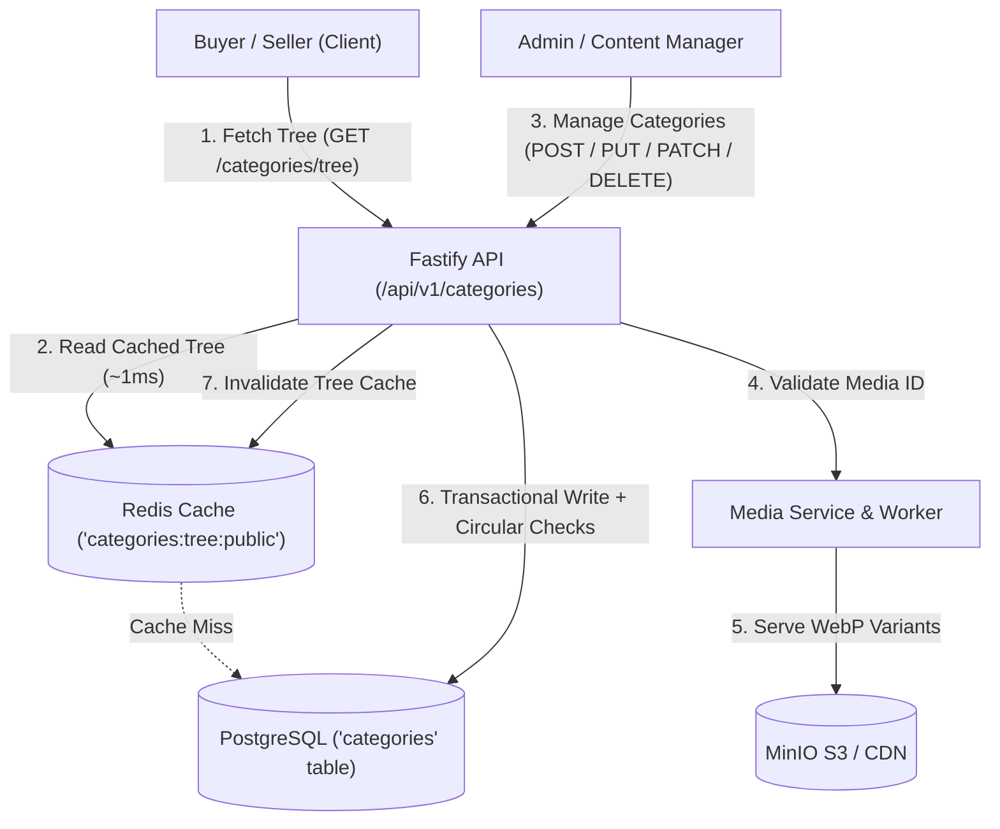

# Hierarchical Category Tree & Dynamic Taxonomy Architecture

Comprehensive architectural reference, database modeling, business rules, and API specifications for the OLX Category System.

---

## 1. System Architecture

The category system utilizes an **Adjacency List Pattern** with strict relational constraints, automated depth enforcement, dynamic specification attribute inheritance, and decoupled Media Service integration.



---

## 2. Relational Schema (`schema.prisma`)

```prisma
model Category {
  id           String              @id @default(uuid()) @db.VarChar(36)
  parentId     String?             @map("parent_id") @db.VarChar(36)
  name         String              @db.VarChar(100)
  slug         String              @db.VarChar(120)
  description  String?             @db.VarChar(500)
  sortOrder    Int                 @default(0) @map("sort_order")
  level        Int                 @default(0)
  imageMediaId String?             @map("image_media_id") @db.VarChar(36)
  iconUrl      String?             @map("icon_url") @db.VarChar(500)
  isActive     Boolean             @default(true) @map("is_active")
  createdAt    DateTime            @default(now()) @map("created_at")
  updatedAt    DateTime            @updatedAt @map("updated_at")

  parent       Category?           @relation("CategoryHierarchy", fields: [parentId], references: [id], onDelete: Restrict)
  children     Category[]          @relation("CategoryHierarchy")
  imageMedia   Media?              @relation(fields: [imageMediaId], references: [id], onDelete: SetNull)
  attributes   CategoryAttribute[]
  ads          Ad[]

  @@unique([parentId, slug])
  @@index([parentId, sortOrder])
  @@index([parentId, isActive])
  @@index([slug])
  @@map("categories")
}
```

### Key Schema Characteristics
- **Adjacency List**: `parentId = null` designates a root category; `parentId != null` designates a child subcategory.
- **Computed `level`**: `0` for root categories, `parent.level + 1` for subcategories.
- **`sortOrder`**: Controls display ordering among siblings sharing the same `parentId`.
- **`imageMediaId`**: Foreign key to `Media` model, delegating image transformations (WebP/AVIF variants) to the Media Service.
- **Indexes**:
  - `@@unique([parentId, slug])`: Enforces unique slugs among siblings under the same parent.
  - `@@index([parentId, sortOrder])`: High-speed sibling retrieval sorted by display position.
  - `@@index([parentId, isActive])`: Filter active navigation trees without full table scans.
  - `@@index([slug])`: Rapid lookup by URL slug.

---

## 3. Core Business Rules & Integrity Guards

### 3.1 Configurable Maximum Depth Limit
- Enforced limit: **`MAX_CATEGORY_DEPTH = 4`** (Level 0: Root, Level 1: Subcategory, Level 2: Brand/Leaf, Level 3: Model).
- Any attempt to create or move a category beyond Level 3 is rejected immediately with **HTTP 400 `MAX_DEPTH_EXCEEDED`**.

### 3.2 Circular Dependency & Self-Parenting Prevention
- **Self-Parenting**: A category cannot have `parentId === id` (rejected with **HTTP 400 `INVALID_PARENT_CATEGORY`**).
- **Cycle Detection**: When updating a category's `parentId`, the system traverses the target parent's ancestors up to the root. If the category's own ID is found in the ancestor chain, the mutation is rejected with **HTTP 400 `CIRCULAR_DEPENDENCY`**.
- **Descendant Level Recalculation**: Moving a branch to a new parent atomically shifts the `level` of all its descendants inside a database transaction (`prisma.$transaction`).

### 3.3 Scoped Slug Uniqueness
- Slugs must be unique **within the same parent** (`@@unique([parentId, slug])`).
- This permits intuitive taxonomies (e.g. `/vehicles/spare-parts` and `/electronics/spare-parts`) while preventing collisions among direct siblings.

### 3.4 Decoupled Media Integration
- Category images/icons must never be stored as binary blobs or unverified URLs in the database.
- Uploads flow through the Media Service:
  ```http
  POST /api/v1/media/images?resource=categories&mediaType=icon
  ```
- The returned `mediaId` is linked to `category.imageMediaId`.
- The database marks the media as `isAttached: true` and `scope: 'CATEGORY_BANNER'`.
- Deleting or replacing the category image automatically resets the old media to `scope: 'UNATTACHED'` for automated orphan cleanup.

### 3.5 Active Listings Guard on Deletion
- **Child Guard**: Categories with existing subcategories cannot be deleted (**HTTP 409 `CATEGORY_HAS_CHILDREN`**).
- **Active Listings Guard**: Categories with live marketplace advertisements (`status: ACTIVE` or `PENDING_REVIEW`) cannot be deleted (**HTTP 409 `CATEGORY_IN_USE`**).
- **Soft Deactivation**: Administrators should set `isActive = false` rather than hard-deleting historical categories. Deactivating a parent cascades deactivation down all descendant categories.

### 3.6 Transactional Sibling Reordering
- The `PATCH /api/v1/categories/reorder` endpoint accepts batch position updates:
  ```json
  {
    "items": [
      { "id": "uuid-1", "sortOrder": 0 },
      { "id": "uuid-2", "sortOrder": 1 }
    ]
  }
  ```
- All positions are updated atomically within a single transaction, preventing duplicate or inconsistent sort sequences.

### 3.7 Dynamic Specification Attribute Inheritance
- Dynamic filter attributes (`CategoryAttribute`) defined on parent categories are automatically inherited by child categories.
- For example, if **Vehicles** defines `price` and **Cars** defines `kms_driven`, fetching attributes for **Toyota** returns both inherited attributes combined, with child-level overrides taking precedence on key collision.

---

## 4. API Endpoints Reference

### 4.1 Public Endpoints

#### `GET /api/v1/categories`
Returns top-level root categories with immediate active children.

#### `GET /api/v1/categories/tree`
Returns the entire active nested category hierarchy in JSON format. Cached in Redis (`categories:tree:public`).

```json
{
  "success": true,
  "data": [
    {
      "id": "6a3daedc-7211-4912-8795-1b3b8f1b4448",
      "parentId": null,
      "name": "Vehicles",
      "slug": "vehicles",
      "sortOrder": 1,
      "level": 0,
      "isActive": true,
      "image": {
        "mediaId": "med_123456",
        "url": "http://localhost:9000/olx-media/categories/icons/large.webp",
        "thumbnailUrl": "http://localhost:9000/olx-media/categories/icons/thumb.webp"
      },
      "adsCount": 1420,
      "children": [
        {
          "id": "b182a4c2-9901-4122-8199-2b3b8f1b9999",
          "parentId": "6a3daedc-7211-4912-8795-1b3b8f1b4448",
          "name": "Cars",
          "slug": "cars",
          "sortOrder": 1,
          "level": 1,
          "isActive": true,
          "children": []
        }
      ]
    }
  ]
}
```

#### `GET /api/v1/categories/:slug`
Fetches a single category by slug, returning its ancestor breadcrumbs, image variants, and direct children.

#### `GET /api/v1/categories/:id/attributes`
Returns all dynamic specification fields required when posting an ad in this category, merged with inherited parent attributes.

---

### 4.2 Administrative Endpoints (Protected)

Requires `fastify.authenticate` and `requirePermission(Permissions.CATEGORIES_MANAGE)` (`SUPER_ADMIN`, `ADMIN`, `CONTENT_MANAGER`).

#### `POST /api/v1/categories`
Creates a new category.

**Request Body**:
```json
{
  "name": "Commercial Vehicles",
  "slug": "commercial-vehicles",
  "parentId": "6a3daedc-7211-4912-8795-1b3b8f1b4448",
  "description": "Trucks, vans, and buses",
  "sortOrder": 3,
  "imageMediaId": "med_987654321",
  "isActive": true
}
```

#### `PUT /api/v1/categories/:id`
Updates category metadata, changes parent category (with cycle validation), or swaps image references.

#### `PATCH /api/v1/categories/reorder`
Atomically reorders siblings.

**Request Body**:
```json
{
  "items": [
    { "id": "458350ef-6296-41a1-87fb-a68026915fde", "sortOrder": 1 },
    { "id": "6a3daedc-7211-4912-8795-1b3b8f1b4448", "sortOrder": 2 }
  ]
}
```

#### `PATCH /api/v1/categories/:id/status`
Toggles active status. Disabling a category cascades deactivation down its entire subcategory subtree.

**Request Body**:
```json
{
  "isActive": false
}
```

#### `DELETE /api/v1/categories/:id`
Permanently deletes a category if unreferenced by subcategories or active ads. Detaches media references cleanly.

---

## 5. Example Marketplace Taxonomies

```text
Vehicles (Level 0)
├── Cars (Level 1)
│   ├── Used Cars (Level 2)
│   │   ├── Maruti Suzuki (Level 3)
│   │   ├── Hyundai (Level 3)
│   │   └── Toyota (Level 3)
│   └── Commercial & Other Vehicles (Level 2)
├── Motorcycles & Scooters (Level 1)
│   ├── Motorcycles (Level 2)
│   └── Scooters (Level 2)
└── Spare Parts & Accessories (Level 1)

Mobiles (Level 0)
├── Mobile Phones (Level 1)
│   ├── Apple iPhones (Level 2)
│   ├── Samsung (Level 2)
│   └── OnePlus (Level 2)
├── Tablets & iPads (Level 1)
└── Accessories (Level 1)

Properties (Level 0)
├── For Sale: Houses & Apartments (Level 1)
├── For Rent: Houses & Apartments (Level 1)
└── Land & Plots (Level 1)
```

