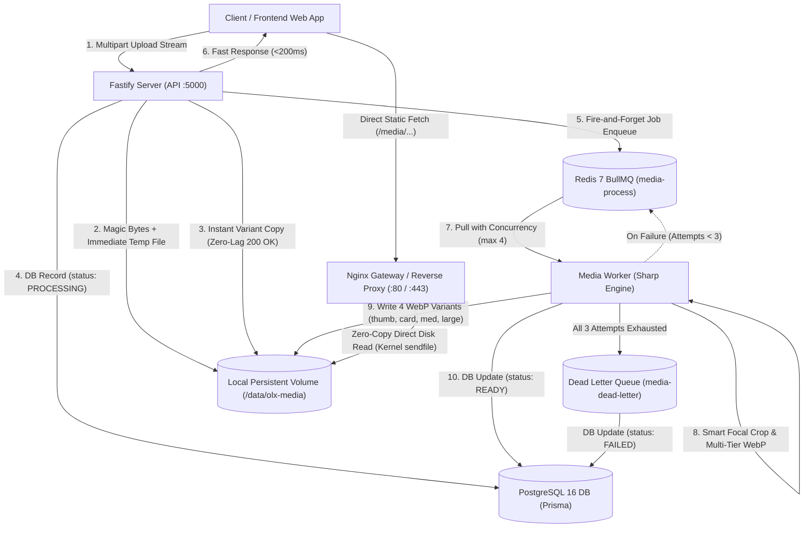

# Universal Media Foundation & Background Processing Pipeline

Comprehensive architectural reference, API specifications, and operational guide for media uploads, image resizing, and local disk delivery in the BharatMarket (OLX) Monorepo.

---

## 1. System Architecture



### Core Architectural Principles

1. **Local Persistent Volume Architecture (Zero-MinIO Overhead)**
   - Media assets are stored on a persistent Docker volume (`media_data`), mounted at `/data/olx-media`.
   - No external S3 or MinIO dependencies required. Reduces container memory usage by >500MB and eliminates external authentication/network latency.
   - Nginx serves all static media requests (`/media/...`) directly from disk using kernel-level `sendfile`, HTTP browser caching (`Cache-Control: public, max-age=2592000`), and `Access-Control-Allow-Origin: *`.

2. **Ultra-Fast Ingestion with Instant Variant Staging (<200ms Response)**
   - When files are uploaded, the Fastify HTTP server validates magic bytes, writes an initial copy directly into the storage location, registers the asset in PostgreSQL with `status: PROCESSING`, and returns `201 Created` immediately.
   - Because the initial copy is already in place, newly created listings load their images with `200 OK` instantly without race-condition `404` errors while the background worker optimizes them.

3. **Multi-Tier WebP Generation via BullMQ & Sharp Libvips**
   - The BullMQ worker processes image optimization jobs with controlled concurrency (`max 4`) to prevent memory thrashing.
   - Sharp compiles 4 distinct WebP variants with focal smart cropping:
     - `thumbnail` (300×300 focal crop, quality 80)
     - `card` (600×450 4:3 focal crop, quality 82)
     - `medium` (800px max width/height, quality 84)
     - `large` (1600px max width/height, quality 86)
   - Storage savings: **~65% to 75%** space reduction compared to original JPEG/PNG files.

4. **Resilient Retry & Dead Letter Queue (DLQ)**
   - Transient processing errors are retried up to 3 times with exponential backoff (2s, 4s, 8s).
   - If all attempts fail, the job moves to `media-dead-letter`, the record is marked `FAILED`, and temporary files are safely unlinked.

---

## 2. Database Schema (`schema.prisma`)

```prisma
enum MediaEntityType {
  LISTING
  USER
  CATEGORY
  BANNER
  CHAT
  SYSTEM
}

enum MediaAssetStatus {
  TEMP
  PROCESSING
  READY
  FAILED
}

model MediaAsset {
  id              String           @id @default(uuid()) @db.VarChar(36)
  ownerId         String           @map("owner_id") @db.VarChar(36)
  entityType      MediaEntityType  @default(LISTING) @map("entity_type")
  entityId        String?          @map("entity_id") @db.VarChar(36)
  storageProvider String           @default("LOCAL") @map("storage_provider") @db.VarChar(20)
  storageKey      String           @unique @map("storage_key") @db.VarChar(500)
  originalName    String           @map("original_name") @db.VarChar(255)
  mimeType        String           @map("mime_type") @db.VarChar(100)
  extension       String           @db.VarChar(20)
  sizeBytes       BigInt           @default(0) @map("size_bytes")
  width           Int?
  height          Int?
  duration        Float?
  checksum        String?          @db.VarChar(64)
  status          MediaAssetStatus @default(TEMP)
  variants        Json?            // { thumbnail: string, card: string, medium: string, large: string }
  metadata        Json?            // { focalPoint: { x, y } }
  failureReason   String?          @map("failure_reason") @db.VarChar(500)
  createdAt       DateTime         @default(now()) @map("created_at")
  updatedAt       DateTime         @updatedAt @map("updated_at")

  owner           User             @relation(fields: [ownerId], references: [id], onDelete: Cascade)
  adImages        AdImage[]

  @@index([ownerId, entityType])
  @@index([status, createdAt])
  @@map("media_assets")
}
```

---

## 3. Directory Layout & Storage Sharding

All files are structured inside `/data/olx-media` using clean domain prefixes:

```
/data/olx-media/
├── ads/
│   └── {adId}/
│       └── images/
│           └── {mediaId}/
│               ├── thumbnail.webp    # 300x300 focal crop
│               ├── card.webp         # 600x450 grid card
│               ├── medium.webp       # 800px preview
│               └── large.webp        # 1600px zoom viewer
├── users/
│   └── {userId}/
│       └── avatar/
│           ├── thumbnail.webp
│           └── card.webp
├── categories/
│   └── {categoryId}/
│       ├── icon.webp
│       └── banner.webp
├── banners/
│   └── {bannerId}/
│       └── desktop.webp
├── chats/
│   └── {conversationId}/
│       └── {mediaId}/
│           └── large.webp
└── temp/
    └── {mediaId}.tmp
```

---

## 4. API Endpoints Reference

### 4.1 Upload Media Images
- **Method**: `POST`
- **Path**: `/api/v1/ads/upload-images` (or `/api/v1/media/images`)
- **Auth**: Bearer Token required
- **Content-Type**: `multipart/form-data`
- **Max file size**: 15MB per image (up to 5000×5000px)

#### Response (`201 Created`):
```json
{
  "success": true,
  "data": [
    {
      "mediaId": "med_mwb8x7291a",
      "originalName": "apartment-front.jpg",
      "mimeType": "image/jpeg",
      "fileSize": 2048500,
      "variants": {
        "thumbnail": "http://localhost/media/ads/drafts/images/med_mwb8x7291a/thumbnail.webp",
        "card": "http://localhost/media/ads/drafts/images/med_mwb8x7291a/card.webp",
        "medium": "http://localhost/media/ads/drafts/images/med_mwb8x7291a/medium.webp",
        "large": "http://localhost/media/ads/drafts/images/med_mwb8x7291a/large.webp"
      }
    }
  ]
}
```

### 4.2 Admin Media Storage Overview & Graphs
- **Method**: `GET`
- **Path**: `/api/v1/admin/media/overview`
- **Auth**: Super Admin / Admin (`MEDIA_MANAGE` permission)

#### Response (`200 OK`):
```json
{
  "success": true,
  "data": {
    "totalFiles": 142,
    "totalFilesFormatted": "142",
    "storageConsumed": {
      "bytes": 28540912,
      "formatted": "27.22 MB",
      "averageSizeBytes": 200992,
      "averageSizeFormatted": "196.28 KB"
    },
    "storageInfrastructure": {
      "driver": "LOCAL_DISK",
      "isLocalDisk": true,
      "storageRoot": "/data/olx-media",
      "volumeName": "media_data",
      "mountPath": "/data/olx-media",
      "syncStatusText": "Local Persistent Volume (/data/olx-media)",
      "isHealthy": true
    },
    "diskBreakdown": [
      {
        "scope": "LISTING",
        "name": "Ad Listings",
        "count": 120,
        "bytes": 24109400,
        "formatted": "22.99 MB",
        "color": "#3b82f6",
        "percentage": 84
      },
      {
        "scope": "CATEGORY",
        "name": "Categories",
        "count": 14,
        "bytes": 2819000,
        "formatted": "2.69 MB",
        "color": "#f59e0b",
        "percentage": 10
      },
      {
        "scope": "USER",
        "name": "User Avatars",
        "count": 8,
        "bytes": 1612512,
        "formatted": "1.54 MB",
        "color": "#10b981",
        "percentage": 6
      }
    ],
    "optimizationTier": {
      "tier": "WebP optimized tier",
      "variantsPerImage": 4,
      "compressionAlgorithm": "Sharp Libvips WebP (Effort 3)",
      "estimatedStorageSaved": "~65%"
    }
  }
}
```

### 4.3 Clean Orphaned Media
- **Method**: `POST`
- **Path**: `/api/v1/admin/media/cleanup-orphans`
- **Auth**: Super Admin / Admin
- **Payload**: `{ "olderThanHours": 24 }` (or `0` to purge all unattached uploads immediately)
- **Action**: Unlinks unattached `MediaAsset` database rows and completely purges all corresponding physical files and directories from the `/data/olx-media` persistent disk volume.
