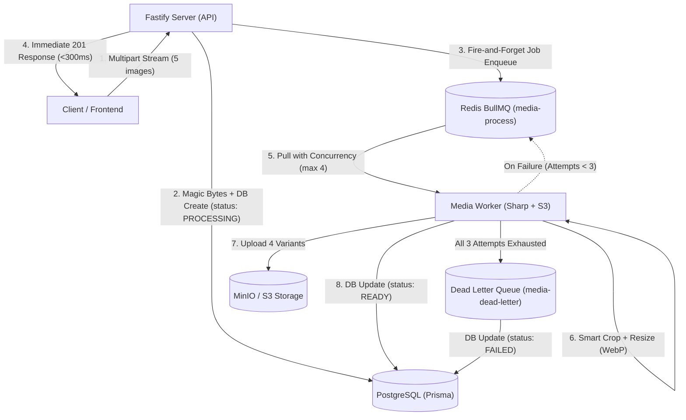

# Universal Media Foundation & Background Processing Pipeline

Comprehensive architectural reference, API specifications, and operational guide for media uploads, image resizing, and delivery in the OLX Monorepo.

---

## 1. System Architecture



### Architectural Principles

1. **Pure Asynchronous Ingestion (<300ms Response)**
   - The Fastify HTTP server never performs image manipulation (Sharp) synchronously and never blocks on background workers.
   - Files are validated against magic bytes (first few bytes) during stream reception, saved to a temporary location, inserted into PostgreSQL with `PROCESSING` status, and enqueued into Redis via BullMQ.
   - The client receives an immediate `201 Created` response containing the server-generated `mediaId` and deterministic variant URLs.

2. **Controlled Worker Concurrency & Memory Protection**
   - The worker processes image jobs with controlled concurrency (`max 4`) to prevent memory spikes and CPU thrashing during multi-threaded libvips (Sharp) processing.

3. **Resilient Retry & Dead Letter Queue (DLQ)**
   - Transient failures are retried up to 3 times using exponential backoff (2s, 4s, 8s). Temporary input files are preserved across retries.
   - When all 3 attempts are exhausted, the job and failure metadata are moved to the `media-dead-letter` queue, the database record is updated to `FAILED`, and the temporary file is deleted.

4. **Dual Storage Driver Support**
   - Supports both MinIO / AWS S3 (`s3`) and local file system (`disk`) seamlessly with human-readable, domain-driven paths:
     - Single-file resources: `users/{userId}/avatar/{variant}.webp`
     - Multi-file resources: `ads/{adId}/images/{mediaId}/{variant}.webp`

---

## 2. Universal Media Table (`schema.prisma`)

A single, unified `Media` model supports listing photos, user avatars, category icons, marketing banners, review attachments, and support tickets.

```prisma
enum MediaType {
  IMAGE
  VIDEO
  DOCUMENT
}

enum MediaStatus {
  PENDING
  PROCESSING
  READY
  FAILED
}

enum MediaEntityScope {
  LISTING_IMAGE
  USER_AVATAR
  CATEGORY_BANNER
  BANNER
  REVIEW_IMAGE
  SUPPORT_ATTACHMENT
  UNATTACHED
}

model Media {
  id           String           @id @default(uuid()) @db.VarChar(36)
  userId       String           @map("user_id") @db.VarChar(36)
  type         MediaType        @default(IMAGE)
  status       MediaStatus      @default(PENDING)
  scope        MediaEntityScope @default(UNATTACHED)
  originalName String           @map("original_name") @db.VarChar(255)
  mimeType     String           @map("mime_type") @db.VarChar(100)
  fileSize     Int              @map("file_size")
  width        Int?
  height       Int?
  diskPath     String           @map("disk_path") @db.VarChar(500)
  variants     Json?            // { thumbnail: string, card: string, large: string }
  errorMessage String?          @map("error_message") @db.VarChar(255)
  isAttached   Boolean          @default(false) @map("is_attached")
  attachedToId String?          @map("attached_to_id") @db.VarChar(36)
  createdAt    DateTime         @default(now()) @map("created_at")
  updatedAt    DateTime         @updatedAt @map("updated_at")

  user         User             @relation(fields: [userId], references: [id], onDelete: Cascade)
  adImages     AdImage[]

  @@index([userId, isAttached])
  @@index([status, createdAt])
  @@index([scope, attachedToId])
  @@map("media")
}
```

---

## 3. Directory Sharding & Filesystem Layout

To avoid filesystem inode saturation and directory performance degradation, images are stored using **two-level MD5 hex sharding**:

```
uploads/
├── temp/                                # Temporary upload streams
│   └── temp_med_1m40ab9876.tmp
└── variants/                            # Published variants
    └── ab/                              # Level 1 shard (MD5[0..1])
        └── cd/                          # Level 2 shard (MD5[2..3])
            └── med_1m40ab9876/          # Media ID folder
                ├── thumb.webp           # 150x150 (cover, quality 80)
                ├── card.webp            # 400x300 (cover, quality 82)
                └── large.webp           # 1200x900 (inside, quality 85)
```

- Max ~256 folders per directory level.
- User-supplied filenames are never used as filesystem paths (prevents path traversal attacks).
- All files re-encoded into optimized WebP formats.

---

## 4. API Endpoints Reference

### 4.1 Upload Images (Up to 8 Photos per Request / Ad, Max 10MB per Photo)
- **Method**: `POST`
- **Path**: `/api/v1/media/images` (also available via `/api/v1/ads/upload-images` and `/api/v1/uploads/upload-images`)
- **Auth**: Required (`fastify.authenticate`)
- **Content-Type**: `multipart/form-data`
- **Limits**:
  - Max 8 photos per listing / request
  - Max 10MB per photo
  - Max dimensions: **Up to 5000 × 5000 pixels** (Aspect ratio preserved)
  - Oversized resolutions exceeding 5000x5000px (such as 6K 6000x4000, 8K 8192x5464) are rejected immediately at the HTTP server with **HTTP 400 `IMAGE_DIMENSIONS_EXCEEDED`**.
  - Standard formats: JPG, JPEG, PNG (WebP, HEIC/HEIF also supported).

#### Error Response for Oversized Images (`400 Bad Request`):
```json
{
  "statusCode": 400,
  "error": "Bad Request",
  "code": "IMAGE_DIMENSIONS_EXCEEDED",
  "message": "Image \"photo.jpg\" resolution (8192x5464) exceeds the maximum allowable limit of 5000x5000px."
}
```

#### Response (`201 Created`):
```json
{
  "success": true,
  "data": [
    {
      "mediaId": "med_1m40ab9876",
      "status": "ready",
      "originalName": "product-front.jpg",
      "mimeType": "image/jpeg",
      "fileSize": 1420580,
      "variants": {
        "thumbnail": "http://localhost:5000/uploads/variants/ab/cd/med_1m40ab9876/thumb.webp",
        "card": "http://localhost:5000/uploads/variants/ab/cd/med_1m40ab9876/card.webp",
        "large": "http://localhost:5000/uploads/variants/ab/cd/med_1m40ab9876/large.webp"
      },
      "url": "http://localhost:5000/uploads/variants/ab/cd/med_1m40ab9876/large.webp",
      "thumbnailUrl": "http://localhost:5000/uploads/variants/ab/cd/med_1m40ab9876/thumb.webp",
      "displayUrl": "http://localhost:5000/uploads/variants/ab/cd/med_1m40ab9876/card.webp"
    },
    {
      "mediaId": "med_2n51cd1234",
      "status": "ready",
      "originalName": "product-back.png",
      "mimeType": "image/png",
      "fileSize": 2189400,
      "variants": {
        "thumbnail": "http://localhost:5000/uploads/variants/ef/gh/med_2n51cd1234/thumb.webp",
        "card": "http://localhost:5000/uploads/variants/ef/gh/med_2n51cd1234/card.webp",
        "large": "http://localhost:5000/uploads/variants/ef/gh/med_2n51cd1234/large.webp"
      },
      "url": "http://localhost:5000/uploads/variants/ef/gh/med_2n51cd1234/large.webp",
      "thumbnailUrl": "http://localhost:5000/uploads/variants/ef/gh/med_2n51cd1234/thumb.webp",
      "displayUrl": "http://localhost:5000/uploads/variants/ef/gh/med_2n51cd1234/card.webp"
    }
  ],
  "count": 2
}
```

---

### 4.2 Get Media Metadata
- **Method**: `GET`
- **Path**: `/api/v1/media/:mediaId`
- **Auth**: Public or Authenticated

#### Response (`200 OK`):
```json
{
  "success": true,
  "data": {
    "mediaId": "med_1m40ab9876",
    "userId": "usr_9982",
    "status": "ready",
    "mimeType": "image/jpeg",
    "fileSize": 2419080,
    "width": 1920,
    "height": 1080,
    "variants": {
      "thumbnail": "http://localhost:5000/uploads/variants/ab/cd/med_1m40ab9876/thumb.webp",
      "card": "http://localhost:5000/uploads/variants/ab/cd/med_1m40ab9876/card.webp",
      "large": "http://localhost:5000/uploads/variants/ab/cd/med_1m40ab9876/large.webp"
    },
    "isAttached": true,
    "attachedToId": "ad_892112",
    "createdAt": "2026-11-04T14:40:00.000Z"
  }
}
```

---

### 4.3 Delete Unattached Image
- **Method**: `DELETE`
- **Path**: `/api/v1/media/:mediaId`
- **Auth**: Required (Owner or Super Admin)
- **Constraint**: Cannot delete media where `isAttached === true`. Must be detached from listing first.

#### Response (`200 OK`):
```json
{
  "success": true,
  "message": "Media deleted successfully"
}
```

---

### 4.4 Create Listing with Media IDs
- **Method**: `POST`
- **Path**: `/api/v1/listings` (or `/api/v1/ads`)
- **Auth**: Required (`CAN_SELL` capability)

#### Request Body:
```json
{
  "title": "Samsung Galaxy S24 256GB Black",
  "description": "Mint condition phone with original box, cable, and receipt.",
  "categoryId": "mobiles-uuid",
  "locationId": "delhi-uuid",
  "price": 42000,
  "images": [
    {
      "mediaId": "med_1m40ab9876",
      "sortOrder": 0,
      "isCover": true
    },
    {
      "mediaId": "med_2n51cd1234",
      "sortOrder": 1,
      "isCover": false
    }
  ]
}
```

*The backend queries the `media` table, verifies caller ownership, ensures `status === 'READY'`, and attaches the media atomically inside `prisma.$transaction`.*

---

### 4.5 Reorder or Replace Listing Images
- **Method**: `PATCH`
- **Path**: `/api/v1/listings/:listingId/images`
- **Auth**: Required (Listing Owner)

#### Request Body:
```json
{
  "images": [
    { "mediaId": "med_2n51cd1234", "sortOrder": 0, "isCover": true },
    { "mediaId": "med_1m40ab9876", "sortOrder": 1, "isCover": false }
  ]
}
```

---

### 4.6 Remove Single Image from Listing
- **Method**: `DELETE`
- **Path**: `/api/v1/listings/:listingId/images/:mediaId`
- **Auth**: Required (Listing Owner)
- **Constraint**: Listing must maintain at least 1 image. If cover photo is removed, the next remaining photo is automatically promoted to cover.

---

## 5. Security & Reliability Controls

| Control | Implementation |
| :--- | :--- |
| **Magic Byte Inspection** | Inspects raw initial byte buffer: JPEG (`FF D8 FF`), PNG (`89 50 4E 47`), WebP (`RIFF...WEBP`). Rejects disguised scripts, HTML, or `.exe` files before processing. |
| **EXIF & Privacy Stripping** | Sharp re-encodes all image variants to WebP without preserving EXIF metadata, automatically stripping GPS coordinates and camera serial numbers. |
| **Path Traversal Defense** | Disk paths are generated strictly via server-controlled media IDs and MD5 hashes. Filesystem calls verify paths remain within the upload root directory. |
| **Atomic Transactions** | Listing creation, image attachment, and status updates execute inside `prisma.$transaction`. |
| **Event Loop Isolation** | Sharp resizing executes exclusively in the background worker process (`@olx/workers`) via BullMQ. The Fastify API server never blocks. |
| **Cache Headers** | Published variants (`/uploads/variants/*`) are served with `Cache-Control: public, max-age=31536000, immutable`. |
| **Orphan Cleanup** | `MediaService.cleanupOrphans(24)` purges unattached and failed uploads older than 24 hours. |

---

## 6. Testing & Verification

Run the test suite from `apps/server`:

```bash
pnpm vitest run tests/unit/media.test.ts
```

### Verification Checklist:
- [x] Magic byte identification (JPEG, PNG, WebP)
- [x] Disguised file rejection (HTML, bash scripts, PE executables)
- [x] MD5 two-level directory sharding calculation
- [x] CDN and fallback URL construction
- [x] Stream saving and temp file cleanup
- [x] Zod schema validation for media IDs and reordering
- [x] Full monorepo build passes (`turbo run build`)

---

## 7. Storage Architecture: Local Development (MinIO) & Production (Hostinger + Cloudflare)

The architecture supports seamless dual-mode storage via `STORAGE_DRIVER=s3` or `STORAGE_DRIVER=disk`.

### 7.1 Architecture Overview

```
[Local Dev / Docker]
Local MinIO Container (:9000 API, :9001 Console)
      ▲
      │ S3 PutObject / GetObject
[Fastify Server & BullMQ Worker]
      │
      ▼ (In Production on Hostinger VPS)
MinIO Object Storage on 10+ TB Disk
      ▲
      │ Origin Pull
Cloudflare CDN (https://images.yourdomain.com)
      ▲
      │ High-speed cached delivery
End Users / Browsers
```

### 7.2 Local Development Setup (MyLocal + MinIO)

1. **Start all infrastructure services (Postgres + Redis + MinIO)**:
   ```bash
   pnpm infra
   # Or:
   pnpm run docker:infra
   ```
2. **Access MinIO Web Console**:
   - URL: `http://localhost:9001`
   - User: `admin_olx`
   - Password: `SuperSecurePassword123`
   - Bucket `olx-media` is automatically created with public read permissions.

3. **Environment Settings (`.env`)**:
   ```env
   STORAGE_DRIVER=s3
   S3_ENDPOINT=http://localhost:9000
   S3_REGION=us-east-1
   S3_BUCKET=olx-media
   S3_ACCESS_KEY=admin_olx
   S3_SECRET_KEY=SuperSecurePassword123
   S3_FORCE_PATH_STYLE=true
   S3_PUBLIC_URL=http://localhost:9000/olx-media
   ```

### 7.3 Production Deployment (Hostinger VPS 10+ TB + Cloudflare CDN)

1. Deploy MinIO on the Hostinger VPS utilizing the local disk storage volume.
2. Point Cloudflare CDN subdomain (e.g., `images.yourdomain.com`) to the MinIO origin.
3. Configure Caching Rules in Cloudflare for `/variants/*` (`Cache Everything`, Edge Cache TTL: 1 year).
4. In production `.env`:
   ```env
   STORAGE_DRIVER=s3
   S3_ENDPOINT=http://minio:9000
   S3_REGION=us-east-1
   S3_BUCKET=olx-media
   S3_ACCESS_KEY=<production_access_key>
   S3_SECRET_KEY=<production_secret_key>
   S3_FORCE_PATH_STYLE=true
   S3_PUBLIC_URL=https://images.yourdomain.com
   ```

---

## 8. Predictable, Human-Readable Media Storage Path Design

The media storage path immediately identifies ownership, parent resource, media type, and processing variant without inspecting the database.

### 8.1 Core Path Rules

* **Single-file resource** (logically one current file, e.g., user avatar, cover, brand logo, category icon):
  ```text
  {resource}/{resourceId}/{mediaType}/{variant}.{format}
  ```
  *(Omit `{variant}` when the resource is delivered as a single canonical asset, e.g., `categories/{categoryId}/icon.webp`)*

* **Multiple-file resource** (contains multiple assets per entity, e.g., ad images, chat attachments):
  ```text
  {resource}/{resourceId}/{mediaType}/{mediaId}/{variant}.{format}
  ```

### 8.2 Standard Directory Structure

```text
olx-media/
├── users/
│   └── usr_123/
│       ├── avatar/
│       │   ├── thumbnail.webp
│       │   └── large.webp
│       └── cover/
│           └── large.webp
│
├── ads/
│   └── ad_456/
│       └── images/
│           ├── img_001/
│           │   ├── original.jpg          # If original asset is retained
│           │   ├── large.webp            # Max 1600px (aspect ratio preserved)
│           │   ├── medium.webp           # Max 800px (aspect ratio preserved)
│           │   ├── thumbnail.webp        # 300x300 (1:1 smart crop around focal point)
│           │   └── card.webp             # 600x450 (4:3 smart crop around focal point)
│           └── img_002/
│               ├── large.webp
│               ├── medium.webp
│               ├── thumbnail.webp
│               └── card.webp
│
├── categories/
│   └── cars/
│       └── icon.webp
│
├── brands/
│   └── toyota/
│       └── logo.webp
│
└── chats/
    └── chat_789/
        └── attachments/
            └── file_101/
                └── large.webp
```

### 8.3 Centralized Path Builder API (`@olx/shared`)

All paths are generated and validated via `buildMediaPath`:

```ts
import { buildMediaPath } from '@olx/shared';

// 1. Ad Listing Image (Multiple files per Ad)
const adImagePath = buildMediaPath({
  resource: 'ads',
  resourceId: 'ad_43x7p',
  mediaType: 'images',
  mediaId: 'img_mw2z4',
  variant: 'large',
  format: 'webp',
});
// Output: "ads/ad_43x7p/images/img_mw2z4/large.webp"

// 2. User Avatar (Single file per user)
const avatarPath = buildMediaPath({
  resource: 'users',
  resourceId: 'usr_82k91',
  mediaType: 'avatar',
  variant: 'thumbnail',
  format: 'webp',
});
// Output: "users/usr_82k91/avatar/thumbnail.webp"

// 3. Category Icon (Single canonical icon)
const categoryIconPath = buildMediaPath({
  resource: 'categories',
  resourceId: 'cars',
  mediaType: 'icon',
  format: 'webp',
});
// Output: "categories/cars/icon.webp"
```


