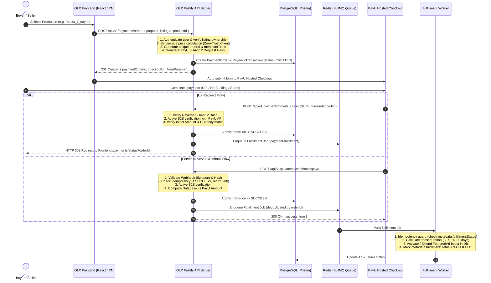
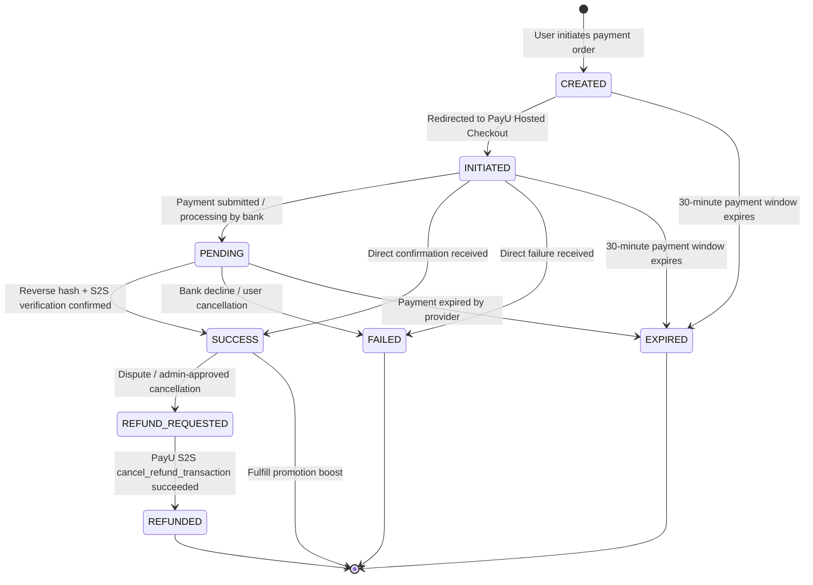

# OLX Payment & Order System — PayU Hosted Checkout

Production-ready, resilient, and secure payment processing pipeline for the OLX marketplace using **PayU Hosted Checkout**, server-controlled product pricing, cryptographic hash verification, dual-channel confirmation (Redirect + Webhook), and asynchronous BullMQ fulfillment.

---

## 1. Architecture & Data Flow



---

## 2. Core Architectural Principles

1. **Zero-Trust Client (Authoritative Backend)**:
   - The frontend **never** sends `amount`, `currency`, `status`, or fulfillment decisions.
   - Prices are resolved strictly server-side using the immutable catalog (`payment.catalog.ts`).
2. **Cryptographic Integrity & Tamper Proofing**:
   - Outbound payment orders are secured with PayU SHA-512 request hashes.
   - Inbound redirect callbacks and asynchronous webhooks are verified using reverse SHA-512 hashes and timing-safe constant-time string comparisons (`crypto.timingSafeEqual`).
3. **Dual-Channel Reconciliation & Verification**:
   - Redirect callbacks (`surl`/`furl`) provide immediate UX response.
   - S2S API verification (`verify_payment`) is executed before marking an order as `SUCCESS`.
   - Webhooks handle dropped connections or users closing their browsers prematurely.
4. **Strict Multi-Level Idempotency**:
   - Webhook retries and redundant redirect calls cannot double-credit or double-boost a listing.
   - Database enforces a unique constraint on `(provider, merchantTransactionId)`.
   - Fulfillment workers check `metadata.fulfillmentStatus === 'FULFILLED'` prior to modifying business state.
5. **Clean Provider Layer Abstraction**:
   - All PayU-specific protocols (hashes, API URLs, request mappers, payload parsers) are encapsulated under `src/modules/payments/providers/payu/` adhering to the clean `PaymentProvider` interface.

---

## 3. Payment State Machine



### Transition Validation Rules

| Current Status | Allowed Next Statuses | Business Rule |
| :--- | :--- | :--- |
| `CREATED` | `INITIATED`, `FAILED`, `EXPIRED` | Order created, awaiting checkout form submission |
| `INITIATED` | `PENDING`, `SUCCESS`, `FAILED`, `EXPIRED` | User reached PayU, transaction opened |
| `PENDING` | `SUCCESS`, `FAILED`, `EXPIRED` | Awaiting bank/UPI settlement response |
| `SUCCESS` | `REFUND_REQUESTED` | Payment confirmed, eligible for administrative refund |
| `FAILED` | *(Terminal State)* | Payment rejected or abandoned |
| `EXPIRED` | *(Terminal State)* | Order expired beyond TTL (30 minutes) |
| `REFUND_REQUESTED`| `REFUNDED`, `SUCCESS` | Refund processing with PayU S2S API |
| `REFUNDED` | *(Terminal State)* | Funds returned to buyer/seller |

---

## 4. Database Schema (`schema.prisma`)

```prisma
enum PaymentPurpose {
  LISTING_BOOST
  FEATURED_LISTING
  TOP_LISTING
  SELLER_SUBSCRIPTION
  OTHER
}

enum PaymentStatus {
  CREATED
  INITIATED
  PENDING
  SUCCESS
  FAILED
  EXPIRED
  REFUND_REQUESTED
  REFUNDED
}

model PaymentOrder {
  id           String         @id
  userId       String
  listingId    String?
  purpose      PaymentPurpose
  productId    String
  amount       Decimal        @db.Decimal(10, 2)
  currency     String         @default("INR")
  status       PaymentStatus  @default(CREATED)
  expiresAt    DateTime
  metadata     Json?
  createdAt    DateTime       @default(now())
  updatedAt    DateTime       @updatedAt

  user         User           @relation(fields: [userId], references: [id], onDelete: Cascade)
  ad           Ad?            @relation(fields: [listingId], references: [id], onDelete: SetNull)
  transactions PaymentTransaction[]

  @@index([userId])
  @@index([listingId])
  @@index([status])
  @@index([createdAt])
  @@map("payment_orders")
}

model PaymentTransaction {
  id                    String        @id @default(uuid())
  paymentOrderId        String
  provider              String        @default("PAYU")
  merchantTransactionId String
  providerTransactionId String?
  amount                Decimal       @db.Decimal(10, 2)
  currency              String        @default("INR")
  status                PaymentStatus @default(CREATED)
  paymentMethod         String?
  providerResponse      Json?
  paidAt                DateTime?
  createdAt             DateTime      @default(now())
  updatedAt             DateTime      @updatedAt

  paymentOrder          PaymentOrder  @relation(fields: [paymentOrderId], references: [id], onDelete: Cascade)

  @@unique([provider, merchantTransactionId])
  @@index([paymentOrderId])
  @@index([status])
  @@map("payment_transactions")
}
```

---

## 5. Server-Side Catalog & Product Catalog

The server catalog defines available products, verified prices in INR, and target purposes:

```typescript
// apps/server/src/modules/payments/payment.catalog.ts

export interface CatalogProduct {
  id: string;
  name: string;
  description: string;
  amount: number;       // In INR (₹)
  currency: string;     // 'INR'
  purpose: PaymentPurpose;
  durationDays?: number;
}

export const PRODUCT_CATALOG: Record<string, CatalogProduct> = {
  // Listing Boosts (Featured Placement)
  boost_3_days: {
    id: 'boost_3_days',
    name: '3-Day Ad Boost',
    description: 'Boost listing visibility for 3 consecutive days',
    amount: 49.0,
    currency: 'INR',
    purpose: 'LISTING_BOOST',
    durationDays: 3,
  },
  boost_7_days: {
    id: 'boost_7_days',
    name: '7-Day Ad Boost',
    description: 'Feature listing at top of category search for 7 days',
    amount: 99.0,
    currency: 'INR',
    purpose: 'LISTING_BOOST',
    durationDays: 7,
  },
  boost_14_days: {
    id: 'boost_14_days',
    name: '14-Day Power Boost',
    description: 'Featured ad ribbon + priority search ranking for 14 days',
    amount: 179.0,
    currency: 'INR',
    purpose: 'LISTING_BOOST',
    durationDays: 14,
  },
  featured_7_days: {
    id: 'featured_7_days',
    name: '7-Day Featured Listing',
    description: 'Home page and category top ribbon for 7 days',
    amount: 149.0,
    currency: 'INR',
    purpose: 'FEATURED_LISTING',
    durationDays: 7,
  },
  top_30_days: {
    id: 'top_30_days',
    name: '30-Day Top of Page Spotlight',
    description: 'Maximum exposure on home page spotlight for 30 days',
    amount: 499.0,
    currency: 'INR',
    purpose: 'TOP_LISTING',
    durationDays: 30,
  },
  seller_pro_monthly: {
    id: 'seller_pro_monthly',
    name: 'Verified Seller Pro Badge (30 Days)',
    description: 'Seller subscription with verified badge and analytics',
    amount: 299.0,
    currency: 'INR',
    purpose: 'SELLER_SUBSCRIPTION',
    durationDays: 30,
  },
};
```

---

## 6. Cryptographic Security Specification

All PayU hashing routines are implemented in [`payu.hash.ts`](file:///e:/bn-projects/olx-srv/olx/apps/server/src/modules/payments/providers/payu/payu.hash.ts).

### 6.1. Request Hash Formula (Outbound)

PayU Hosted Checkout form requires a SHA-512 signature computed in the exact pipe-delimited sequence:

$$\text{hash} = \text{SHA512}(\text{key} \mid \text{txnid} \mid \text{amount} \mid \text{productinfo} \mid \text{firstname} \mid \text{email} \mid \text{udf1} \mid \text{udf2} \mid \text{udf3} \mid \text{udf4} \mid \text{udf5} \mid \mid \mid \mid \mid \mid \text{SALT})$$

```typescript
export function generatePayUHash(params: PayUHashParams, salt: string): string {
  const hashString = [
    params.key,
    params.txnid,
    Number(params.amount).toFixed(2),
    params.productinfo,
    params.firstname,
    params.email,
    params.udf1 || '',
    params.udf2 || '',
    params.udf3 || '',
    params.udf4 || '',
    params.udf5 || '',
    '', '', '', '', '', // empty udf6 to udf10
    salt,
  ].join('|');

  return crypto.createHash('sha512').update(hashString).digest('hex').toLowerCase();
}
```

### 6.2. Reverse Response Hash Formula (Inbound)

When PayU returns to SURL/FURL or posts to Webhook, the signature is computed in reverse order:

$$\text{hash} = \text{SHA512}(\text{additionalCharges} \mid \text{SALT} \mid \text{status} \mid \mid \mid \mid \mid \mid \text{udf5} \mid \text{udf4} \mid \text{udf3} \mid \text{udf2} \mid \text{udf1} \mid \text{email} \mid \text{firstname} \mid \text{productinfo} \mid \text{amount} \mid \text{txnid} \mid \text{key})$$

### 6.3. Constant-Time Verification

To eliminate timing side-channel attacks, signatures are compared using `crypto.timingSafeEqual`:

```typescript
export function verifyPayUResponseHash(response: PayUResponseHashParams, salt: string): boolean {
  const calculatedHash = generatePayUResponseHash(response, salt);
  const receivedHash = (response.hash || '').toLowerCase();

  const bufA = Buffer.from(calculatedHash, 'utf8');
  const bufB = Buffer.from(receivedHash, 'utf8');

  if (bufA.length !== bufB.length) return false;
  return crypto.timingSafeEqual(bufA, bufB);
}
```

---

## 7. API Reference

### 7.1. Create Payment Order

Creates an order, validates listing ownership, generates merchant transaction ID, and returns PayU hosted checkout form parameters.

- **URL**: `POST /api/v1/payments/orders`
- **Authentication**: Required (`Bearer JWT`)
- **Rate Limit**: 10 requests / minute

#### Request Body
```json
{
  "purpose": "LISTING_BOOST",
  "listingId": "lst_8a49c201-1b82-4f70-9831-e129cd846415",
  "productId": "boost_7_days"
}
```

#### Response (`201 Created`)
```json
{
  "paymentOrderId": "payord_m192ab3c_7f8a12",
  "merchantTransactionId": "OLX_20261106_C8A1B29F",
  "amount": 99.0,
  "currency": "INR",
  "purpose": "LISTING_BOOST",
  "status": "CREATED",
  "expiresAt": "2026-11-06T11:45:00.000Z",
  "checkout": {
    "provider": "PAYU",
    "checkoutUrl": "https://test.payu.in/_payment",
    "method": "POST",
    "params": {
      "key": "test_merchant_key",
      "txnid": "OLX_20261106_C8A1B29F",
      "amount": "99.00",
      "productinfo": "boost_7_days",
      "firstname": "Rahul",
      "email": "seller@bharatmarket.in",
      "phone": "9876543210",
      "surl": "http://localhost:5000/api/v1/payments/payu/success",
      "furl": "http://localhost:5000/api/v1/payments/payu/failure",
      "hash": "3f88a91c2b...",
      "udf1": "payord_m192ab3c_7f8a12",
      "udf2": "lst_8a49c201-1b82-4f70-9831-e129cd846415",
      "udf3": "LISTING_BOOST",
      "udf4": "boost_7_days",
      "udf5": "c42c726f-70ce-4f86-833b-85c5bb1db736"
    }
  }
}
```

---

### 7.2. Inspect Payment Order

Fetches real-time status and transaction history of an order.

- **URL**: `GET /api/v1/payments/orders/:id`
- **Authentication**: Required (`Bearer JWT` — Owner or Admin)

#### Response (`200 OK`)
```json
{
  "id": "payord_m192ab3c_7f8a12",
  "userId": "c42c726f-70ce-4f86-833b-85c5bb1db736",
  "listingId": "lst_8a49c201-1b82-4f70-9831-e129cd846415",
  "purpose": "LISTING_BOOST",
  "productId": "boost_7_days",
  "amount": 99.0,
  "currency": "INR",
  "status": "SUCCESS",
  "expiresAt": "2026-11-06T11:45:00.000Z",
  "metadata": {
    "fulfillmentStatus": "FULFILLED",
    "fulfilledAt": "2026-11-06T11:16:30.124Z"
  },
  "transactions": [
    {
      "id": "txn_89ab3c-45de",
      "merchantTransactionId": "OLX_20261106_C8A1B29F",
      "providerTransactionId": "403993715530182931",
      "amount": 99.0,
      "status": "SUCCESS",
      "paymentMethod": "UPI",
      "paidAt": "2026-11-06T11:16:29.800Z"
    }
  ]
}
```

---

### 7.3. PayU Redirect Handlers (SURL / FURL)

Receives the browser form-post from PayU Hosted Checkout. Reconciles payment and redirects the user to the frontend result view.

- **Success URL**: `POST /api/v1/payments/payu/success`
- **Failure URL**: `POST /api/v1/payments/payu/failure`
- **Content-Type**: `application/x-www-form-urlencoded`
- **Response**: `302 Found` $\rightarrow$ `Location: http://localhost:5173/payments/status?orderId=...&status=...`

---

### 7.4. PayU Asynchronous Webhook

Direct server-to-server webhook callback sent by PayU.

- **URL**: `POST /api/v1/payments/webhooks/payu`
- **Authentication**: PayU Signature & SHA-512 Hash
- **Payload**: JSON or `application/x-www-form-urlencoded`

#### Processing Steps:
1. Validate reverse hash signature using `PAYU_MERCHANT_SALT`.
2. Find `PaymentTransaction` by `merchantTransactionId`.
3. If current status is already `SUCCESS`, return HTTP 200 immediately (Idempotency).
4. Run S2S `verify_payment` API call with PayU.
5. Verify `paidAmount == order.amount` and `currency == 'INR'`.
6. Atomic database update $\rightarrow$ status = `SUCCESS`.
7. Dispatch fulfillment job to BullMQ queue `payment-fulfillment`.

#### Response (`200 OK`)
```json
{
  "success": true,
  "orderId": "payord_m192ab3c_7f8a12",
  "status": "SUCCESS"
}
```

---

### 7.5. Refund Payment (Admin / Staff)

Initiates an automated refund through PayU's S2S refund API (`cancel_refund_transaction`).

- **URL**: `POST /api/v1/payments/:id/refund`
- **Authentication**: Required (`ADMIN` or `STAFF` role)

#### Request Body
```json
{
  "reason": "Customer requested cancellation within 1 hour",
  "amount": 99.0
}
```

#### Response (`200 OK`)
```json
{
  "success": true,
  "paymentOrderId": "payord_m192ab3c_7f8a12",
  "refundId": "ref_91a0c8b",
  "status": "REFUNDED",
  "amount": 99.0
}
```

---

## 8. Asynchronous Fulfillment Worker

Implemented in [`payment-fulfillment.worker.ts`](file:///e:/bn-projects/olx-srv/olx/apps/workers/src/workers/payment-fulfillment.worker.ts):

- **BullMQ Queue Name**: `payment-fulfillment`
- **Job Concurrency**: 5 workers
- **Idempotency**: Inspects `metadata.fulfillmentStatus === 'FULFILLED'`. If fulfilled, safely returns `{ alreadyFulfilled: true }`.
- **Fulfillment Logic**:
  - `LISTING_BOOST` / `FEATURED_LISTING`:
    - Reads product duration (`boost_3_days` $\rightarrow$ 3 days, `boost_7_days` $\rightarrow$ 7 days, `top_30_days` $\rightarrow$ 30 days).
    - Checks for existing active boost on listing. If active, extends `expiresAt = currentExpiry + duration`. If none, creates a new `FeaturedAd` record starting from `now()`.
    - Updates listing `isFeatured = true`.
  - `SELLER_SUBSCRIPTION`:
    - Activates user's verified seller status for the subscription period.
  - Updates `PaymentOrder.metadata` with `fulfillmentStatus: 'FULFILLED'` and `fulfilledAt: ISOString`.

---

## 9. Security & Anti-Fraud Checklist

- [x] **Salt Isolation**: `PAYU_MERCHANT_SALT` exists solely in server environment variables and is never transmitted to clients.
- [x] **Zero Client Pricing**: Pricing is looked up strictly from server-side catalog; client-submitted amounts are rejected.
- [x] **Timing Attack Defense**: Reverse hashes are validated using `crypto.timingSafeEqual`.
- [x] **Strict Amount Reconciliation**: Paid amount must match expected order amount down to the exact paisa (`amount == order.amount`).
- [x] **Transaction ID Uniqueness**: Database enforces `UNIQUE(provider, merchantTransactionId)` preventing replay attacks.
- [x] **Redundant Idempotency**: Webhook and redirect channels cannot execute double fulfillment.
- [x] **Full Audit Logging**: Order creation, payment capture, failures, webhooks, and refunds emit immutable audit logs.

